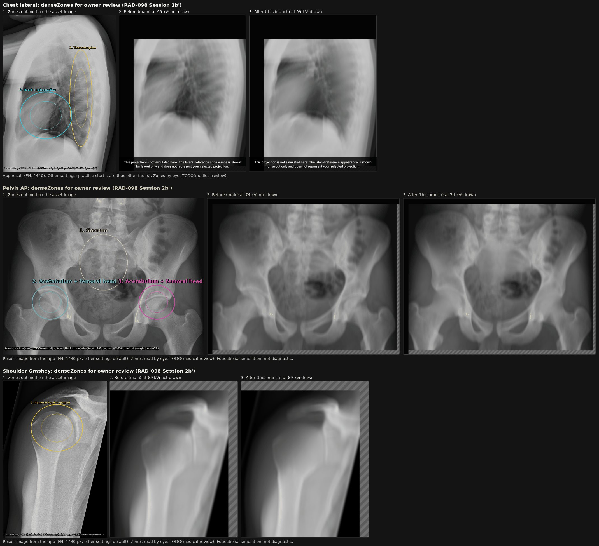

# RAD-098 — محرك صورة الأشعة، الجلسة 2b'، 2026-11-04

## 1. الانحرافات والميزانية

الشرط المسبق: الجلسة 3b (#228) مدمجة في origin/main (Verified قبل البدء)؛ فرع جديد من origin/main وDraft واحد.
الميزانية المعلنة قبل التعديل: ≤12 ملفًا و≤2 وحدة منتج. المستخدم: 11 ملفًا، و0 وحدات منتج مشتركة (ملفات البيانات الثلاثة فقط في `src/data/cases`).
الملفات: DECISIONS، `chest-lateral-radiograph.ts`، `pelvis-ap-radiograph.ts`، `shoulder-grashey-radiograph.ts`، ملف الشهود، `scene-dom/hashes.json`، صورة المراجعة، هذا التقرير، project-status، HANDOFF، فهرس التقارير (docs:sync).
انحرافان معلنان:
- **صورة مراجعة واحدة لا ثلاث:** فهرس التقارير الذي يولده docs:sync كان سيجعل الملفات 13. فجُمعت الأصول الثلاثة في صورة واحدة بثلاثة صفوف (لكل أصل: المناطق، قبل، بعد). وهي JPEG (جودة 84) للبقاء تحت حد الصورة الجديدة 500 KiB.
- **مفاتيح scene-dom لـChest Lateral (46):** لم تُذكر في صيغة المهمة، وأُعلنت قبل تطبيقها: إعداد kVp الافتراضي (70) تحت النطاق، فكل نتيجة Chest Lateral عدا highKv تتضمن نقص الاختراق. هذا هو الأثر المتوقع نفسه (§4).

## 2. المنجز والمستبعد

- **منجز (Draft):** قرار المالك في DECISIONS ([المرساة](../../../DECISIONS.md#radiograph-densezones-owner-2026-11-04)) في الالتزام الأول؛ denseZones للأصول الثلاثة؛ تحديث التعليق القديم في Chest Lateral؛ صورة المراجعة.
- **خارج النطاق ولم يُلمس:** الآلية والثوابت وTUNING والدرجات والأحكام والفحوص ونصوص EN/AR والأصول، و3c (أصابع رسم الإعداد، clip-margin-only)، وAssess/pilot.

## 3. لكل مهمة: RAD-098

تبقى planned وwaiting_on=owner: يراجع المالك صورة المناطق قبل الدمج. لا ready/merge.

## 4. التغييرات المشتركة وScale

لا وحدة مشتركة تغيرت. البيانات فقط، بالصيغة القائمة `{cu,cv,ru,rv}` (إحداثيات الصورة المطبّعة)، مقروءة بالعين من صورة كل أصل، وعليها TODO(medical-review):

| الأصل | المنطقة | cu | cv | ru | rv |
|---|---|---|---|---|---|
| Chest Lateral | العمود الفقري الصدري (أجسام الفقرات) | 0.69 | 0.53 | 0.1 | 0.31 |
| Chest Lateral | القلب والمنطقة خلف القلب | 0.38 | 0.64 | 0.23 | 0.15 |
| Pelvis AP | العجز | 0.5 | 0.41 | 0.12 | 0.18 |
| Pelvis AP | الحُق ورأس الفخذ، يسار الصورة | 0.235 | 0.665 | 0.09 | 0.11 |
| Pelvis AP | الحُق ورأس الفخذ، يمين الصورة | 0.765 | 0.665 | 0.09 | 0.11 |
| Shoulder Grashey | رأس العضد مع الجوف الحقاني | 0.52 | 0.3 | 0.25 | 0.15 |

الوزن القائم (`denseZoneWeight`): كامل داخل 0.6 من نصف القطر، ويتلاشى إلى صفر عند 1.05. لم يحتج أي منها شيئًا غير قراءة الصورة.
**الشهود (أداة قائمة تجريبية خارج المستودع ترفض أي صف آخر):** أُعلن قبل التعديل 9 صفوف: `penetration/min` و`penetration/threshold-low` و`combination` × الفحوص الثلاثة. تغيّرت هي فقط (plan، soloPlan، luma، soloLuma، effects ← أضيف low-penetration). الأداة أثبتت أيضًا أن تفريغها على main يطابق الملف المقفل في كل صف.
الخطط المعزولة الجديدة تساوي هاشاتها قبل D-R1 حرفيًا (a8b790eb، ffe15574، a6238977): الأثر عاد بشكله المرسوم السابق. الخطط الكاملة تختلف عن ما قبل D-R1 بسبب ضجيج الجلسة 2b فقط.
**scene-dom:** تغيّر 46 مفتاح `result|chest-lateral-erect|*` (كل الحالات عدا highKv)، ولا مفتاح غيرها؛ وطُبقت بأداة ترفض غيرها. فرق الترميز (EN/AR، الحالة الافتراضية): أضيف `low-penetration` إلى data-effects، وعبارة «reduced visibility behind the heart and in the mediastinum» / «انخفاض الوضوح خلف القلب وفي المنصف» في النص البديل، وبطاقة نقص الاختراق؛ صار data-drawn=true، وحُذف وسم «غير مرسوم» للمتغير وللفحص. هاشات الحوض والكتف لا تتضمن kVp منخفضًا فلم تتغير.
النصوص كلها قائمة: الحوض والكتف لهما نصوص عائلة خاصة («dense pelvic/shoulder structures»)؛ نص الصدر يذكر العمود الفقري والرئة خلف القلب، وهما منطقتا Chest Lateral.
Scale: لا سقف جديد.

## 5. الطب والدرجات

Verified: الدرجات والأحكام والفحوص ونصوص EN/AR بلا تغيير (الاختبارات وscene-dom للحوض والكتف مطابقة). لا قيم أو حقائق أو صور طبية جديدة؛ المناطق تقريب تعليمي مقروء بالعين ويحتاج مراجعة مختص.
حد معلن: المنطقة شكل بيضاوي حول البنية، فهي تشمل نسيجًا حولها، والأثر قيمة TUNING ثابتة تحت النطاق (لا تدرج مع kVp).

## 6. QA

| التصنيف | البند |
|---|---|
| Verified | CI unit (`CI=true CI_TEST_LANE=unit npm run check`): typecheck، lint (0 أخطاء وتحذيرا vb/inv السابقان)، 2577/2578؛ الفشل الوحيد scene-dom قبل تطبيق المفاتيح الـ46 المعلنة. بعدها qa وradiograph وexam وevaluation: 1779/1779، ومنها الشهود والعقد السببي D-R1 وهوية النطاق وcharacterisation/goldens وscenario-matrix واختبارات العائلات. |
| Verified | `npm run build` مرة للفرع، ثم build:pages للحجم؛ health:source وhealth:test (9/9) وhealth:sizes بلا أخطاء. |
| Verified | تدقيق kVp منخفض في المتصفح (نسخة مؤقتة): الفحوص الثلاثة × EN/AR × 390/1440 عند أقرب kV راسب (99/74/69)، axe WCAG2.1 A/AA وبلا تجاوز أفقي ونص بديل: 48/48 على main و48/48 على الفرع. main: لا أثر، data-drawn=false، 6 وسوم «غير مرسوم». الفرع: low-penetration مرسوم، data-drawn=true، 5 وسوم، وبكسلات مختلفة. |
| Verified | exam-audit للفحوص الثلاثة EN/AR × 390/1440: 198 فحصًا، 0 إخفاق. |
| Verified | الأداء 390×844، Chromium، main مقابل الفرع (10 إحماءات، 31×3 عينات)، وسيط ms: Chest Lateral baseline 42.8→41.9، rotation 60.2→60.6، kV منخفض 133.8→129.2؛ Pelvis 97.7→98.1، 329.4→332.3، 353.3→351.8؛ Shoulder 27.5→27.9، 77.2→78.8، 85.8→82.5. المدى −3.8%…+2.1%. |
| Verified | marker الـpilot على main والفرع مطابق: `pilot-v1:e2351641d105315383cb684f6c6ef1e918e1cd0bd2fc5dc2f1740d0ae301a7f1` (عنوان Supabase عام اصطناعي). |
| Verified | docs:sync مرتان (الثانية بلا تغيير)، docs:check، status:check --base origin/main --require-previous، git diff --check. |
| Inferred | قياس أول بـ9 عينات أظهر +12% و+21% لـbaseline؛ مسار الكود نفسه (المناطق لا تُحسب بلا نقص اختراق)، فهو ضجيج، وأكده القياس الأطول. |
| Not run | هاتف حقيقي، مراجعة طبية/تعليمية للمناطق، CI البعيد (يعمل عند فتح Draft). |

## 7. المفتوح

- **مراجعة المالك للمناطق** قبل الدمج (§8)؛ أي تعديل مكان أو حجم = تغيير بيانات فقط وإعادة الصفوف التسعة نفسها.
- TODO(medical-review) يبقى على المناطق الست حتى مراجعة مختص مسجلة.
- 3c (أصابع رسم الإعداد، clip-margin-only، ENGINE_GUIDE بند 6) كما في [تقرير 3b](RAD-098_RADIOGRAPH_SESSION3B_2026-11-04.md#7-المفتوح).

## 8. قائمة المالك وبرومبت الجلسة التالية

1. راجع صورة المناطق: [densezones-review.jpg](../../../review/rad-098-densezones/densezones-review.jpg) — ثلاثة صفوف (Chest Lateral، Pelvis AP، Shoulder Grashey)؛ في كل صف: المناطق على صورة الأصل بأسمائها، ثم صورة النتيجة من التطبيق قبل (main) وبعد (الفرع) عند kV منخفض.
2. لكل منطقة: اقبلها، أو اذكر الاتجاه (أوسع/أضيق/أعلى/أسفل) والبنية.
3. تبقى Draft؛ لا ready/merge.

**برومبت مسودة — الجلسة 3c:** اقرأ AGENTS وHANDOFF وRAD-098 وتقريري 3b و2b'. طبّق أولًا ملاحظات المالك على المناطق إن وُجدت (بيانات فقط، والصفوف التسعة نفسها بأداة القائمة). ثم 3c ضمن D-R1–D-R3 كما يقرر المالك في §7 من تقرير 3b. فرع جديد وDraft واحد.
