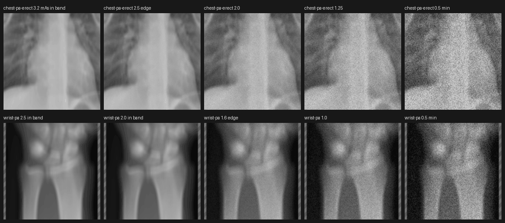

# RAD-098 — محرك صورة الأشعة، الجلسة 2b، 2026-11-03

## 1. الانحرافات والميزانية

الميزانية: ≤10 ملفات و≤3 وحدات منتج مشتركة. المستخدم: 10 ملفات، ووحدة منتج واحدة (`plan.ts`).
الملفات: plan.ts، radiograph-pixel-witnesses.json، characterisation/chest-pa-scenarios.json، golden/matrix.json، DECISIONS.md، project-status.md، HANDOFF.md، هذا التقرير، فهرس التقارير (docs:sync)، ولقطة المسح (228KB).
انحرافات معلنة:
- لم أذكر `golden/matrix.json` في التوقع الأول؛ فهو يثبّت هاش رسم الشبح لنفس السيناريوهات الستة. تغيّر 6 هاشات فقط، والمجموعة مطابقة للتوقع.
- «تبرير لكل هاش»: 132 هاشًا لا تتسع لسقف 150 سطرًا ولا لملف تفاصيل ضمن 10 ملفات. التبرير لكل فئة صف (§4)، والأداة رفضت أي صف خارج الفئة. كل زوج قديم/جديد في diff الالتزام 37488e4.
- الحافة تُقرأ من `technique.deviation.ideal[0]` القائم (حد النجاح نفسه في engine.ts)، فالرسّام يقرأ الآن نطاق DI مؤقتًا من بيانات الحالة. لا رقم DI جديد.

## 2. المنجز والمستبعد

- **منجز (Draft):** قرار المالك أولًا ([radiograph-dr2-amended-owner-2026-11-03](../../../DECISIONS.md#radiograph-dr2-amended-owner-2026-11-03)) ثم التنفيذ في التزام مستقل.
- **قبل الجلسة:** أُصلح تعارض #224 مع main بطلب المالك، ثم دُمجت #224.
- **خارج النطاق:** denseZones، قص القدم، الهندسة، استمرارية الدوران، الأصول، الدرجات، اختبارات جديدة، Assess/pilot.

## 3. لكل مهمة: RAD-098

تبقى planned وwaiting_on=owner (مراجعة هذه المسودة)، ثم denseZones والجلسات 3–4. لا ready/merge.

## 4. التغيير، الشهود المتغيرة، وScale

`plan.ts`: داخل النطاق (المستوى target/reduced) الإضافة صفر كما كانت. تحت الحافة:
σ = `sigmaPerUnit`·√(rel²·ratioₑ − 1) و gain = 1/(1 + `detailLoss`·(rel²·ratioₑ − 1))، حيث ratioₑ = `exposureRatioFromDI(ideal[0])` الدالة العكسية القائمة.
هي العلاقة القائمة √(rel² − 1) نفسها مرجعها الحافة لا الهدف، فتبدأ من 0 عند الحافة وتزيد باستمرار، وتختفي قفزة الفئة. البطاقة والحكم والدرجة على المستوى المحتسب نفسه. لا سطوع (معالجة العرض تحفظ المتوسط)، والزيادة لا تُظلم شيئًا (rel ≤ 1 ⇒ صفر).
**أثر يجب أن يراه المالك:** إزالة القفزة تُنقص الضجيج عند كل تعريض تحت النطاق، لا عند الحافة فقط (الجدول التالي).

### Chest PA — كل السيناريوهات المتغيرة (6 من 53)

| السيناريو | الفئة | التقني | الهاش (render؛ matrix) |
|---|---|---|---|
| mas-low | insufficient | σ 14.61→12.37، gain 0.603→0.679 | 6863bccc→88423f13؛ 040b113b→b6b4f9f3 |
| mas-very-low | insufficient | σ 22.54→19.67، gain 0.389→0.456 | a215f305→39cd1918؛ b0312131→58c5a237 |
| kvp-105 | below-target | σ 6.32→3.88، gain 0.890→0.956 | 054b5530→20fec00e؛ 3c9f009d→385bbc6f |
| sid-200 | below-target | σ 5.71→3.04، gain 0.909→0.972 | 849127c0→988b9a45؛ 5bb3a879→82d738a8 |
| combo-low-kvp-low-mas | insufficient | σ 35.00→30.92، gain 0.209→0.253 | fbdee844→541ee870؛ 32717622→af018b0e |
| combo-all-wrong | insufficient | σ 17.54→15.09، gain 0.513→0.587 | 36584730→1b1a216f؛ 9b180cb7→50186c9c |

التبرير لكل هاش: سيناريو تحت النطاق، تغيّر noiseSigma/detailGain فقط بالمرساة الجديدة. لم تتغير الدرجة والفحوص والنصوص والنص البديل والتأثيرات (diff حقلي).
**إثبات عدم التغير:** `correct` و46 سيناريو آخر (كلها داخل النطاق أو فوقه) مطابقة بايتًا ببايت في characterisation وmatrix. Golden checksums لم تتغير.

### الشهود — 120 صفًا من 1293، كلها تحت النطاق (low-exposure نشط قبل التعديل)

| فئة الصف (لكل الفحوص الـ17) | الحقول | التبرير |
|---|---|---|
| exposure/min، exposure/threshold-low | plan، soloPlan، luma، soloLuma | ضجيج التعريض المعزول نفسه يتغير بالمرساة |
| combination | plan=soloPlan، luma=soloLuma | المركب يتضمن تعريضًا أدنى |
| penetration/min، threshold-low، before-low؛ excess-exposure/min | plan، luma | kVp/mAs الأدنى يضع التعريض تحت النطاق؛ المعزول (اختراق/زائد) لا يتغير |
| chest-ap-supine projection/lateral-left | plan، luma | توهين الإسقاط يضعه تحت النطاق |

**إثبات عدم التغير:** 1173 صفًا بايتًا ببايت، بينها كل صفوف before-low للتعريض (داخل النطاق، σ=0) والأساس. حُدّثت الحقول المسماة فقط بأداة ترفض أي صف أو حقل خارج القائمة المعلنة قبل التعديل. العقد السببي D-R1 أخضر: عند كل حافة تختلف luma المعزولة.
عينة عند الحافة (exposure/threshold-low، luma): chest-pa 35e7a7da→6b83c307؛ wrist-pa 9f48e966→77714b2e؛ pelvis e8a1e102→2c8c35c2؛ shoulder bca8ba6d→5f2d5036.

### الاستمرارية (مقيسة من plan)

| الفحص | داخل النطاق | الحافة | ثم ... | الأدنى |
|---|---|---|---|---|
| Chest PA (120kV/180cm) | 3.2 mAs σ0 | 2.5 σ1.16 | 2.0 σ4.68؛ 1.25 σ9.15 | 0.5 σ18.19 |
| Wrist PA (60kV/102cm) | 2.0 σ0 | 1.6 σ4.42 | 1.0 σ8.94 | 0.5 σ15.51 |

القفزة القديمة عند الحافة كانت ≥4.6 لكل حالة؛ الآن تبدأ من قرب 0 (محطات mAs في الأطراف أبعد عن الحافة، لذا 4.42).

المسح عبر الواجهة الحقيقية بإعدادات الحالة الأولية (حركة/إسقاط خاطئ، لذا الضبابية من الحركة لا التعريض)، 1440 EN، قصّ وسط اللوحة.
Scale: لا سقف جديد؛ الحافة بيانات حالة اختيارية قائمة لكل ملف تقني.

## 5. الطب والدرجات

Verified: لا تغيير في الدرجات أو الأحكام أو الفحوص أو EN/AR أو النص البديل (characterisation حقليًا وscene-dom دون تغيير). لا قيم طبية أو صور جديدة. TUNING دون تغيير.
Inferred: إضافة الضجيج تربيعيًا فوق ضجيج الصورة الأصلية عند الحافة تتسق مع الضجيج الكمي ∝ 1/√التعريض؛ المقادير تبقى تقريبًا تعليميًا غير معاير.

## 6. QA

| التصنيف | البند |
|---|---|
| Verified | CI unit (`CI=true CI_TEST_LANE=unit npm run check`): typecheck وlint (تحذيرا vb/inv السابقان) و2564/2564 في 152 ملفًا. |
| Verified | radiograph/exam/qa/evaluation 1765/1765: الشهود للفحوص الـ17 والعقد السببي، Chest PA characterisation وgoldens وscenario-matrix. |
| Verified | build وbuild:pages؛ health:source وhealth:sizes بلا أخطاء؛ health:test 9/9. |
| Verified | مسح المتصفح Chest PA وWrist PA، EN/AR × 390/1440، 5 محطات لكل منهما: axe WCAG2.1 A/AA وعدم الفيض وعدم أخطاء الصفحة: 88 فحصًا، 0 إخفاق. ظهرت low-exposure عند الحافة المتوقعة تمامًا. |
| Verified | أداء 390×844، Chromium، 3 إحماءات/9 عينات، الفرع مقابل main لـ17 فحصًا: 15 فحصًا ضمن ±10%. تجاوز قصير: Chest PA baseline +11.7% وWrist PA rotation +14.2%، وخطتاهما متطابقتان بايتًا (ليستا تحت النطاق). |
| Verified | إعادة القياس الموسّع (25 إحماءً، 5×51 عينة، AB/BA): Chest PA baseline 42.3→41.9ms (−0.9%)، rotation 164.2→163.8؛ Wrist PA baseline 47.2→49.1 (+4.0%)، rotation 139.7→140.0 (+0.2%). لا تراجع >10%. |
| Verified | docs:sync مرتان بثبات، docs:check، status:check --base origin/main --require-previous، git diff --check. |
| Not run | هاتف حقيقي، مراجعة طبية/فيزيائية، CI البعيد بعد push. صور golden PNG (qa:visual) لم يُعد التقاطها، فالستة لا تطابق الرسم الآن (§7). |

## 7. المفتوح

- golden PNG يدوية للسيناريوهات الستة (mas-low، mas-very-low، kvp-105، sid-200، combo-low-kvp-low-mas، combo-all-wrong) تمثل الضجيج القديم. checksum المقفل لم يتغير، والتقاطها يتجاوز الميزانية. المالك يقرر إعادة الالتقاط في دفعة لاحقة.
- الحافة نطاق DI مؤقت محلي (provisional)؛ تغييره يغيّر الحافة المرسومة تلقائيًا.

## 8. قائمة المالك

1. راجع جدول Chest PA ونقصان الضجيج تحت النطاق ولقطة المسح.
2. قرر إعادة التقاط golden PNG الست.
3. تبقى Draft؛ لا ready/merge. التالي: denseZones (مرجع + مراجعة) ثم الجلسة 3 ([مسودة البرومبت](RAD-098_RADIOGRAPH_SESSION2_2026-11-03.md#8-قائمة-المالك-وبرومبت-الجلسة-3)).
