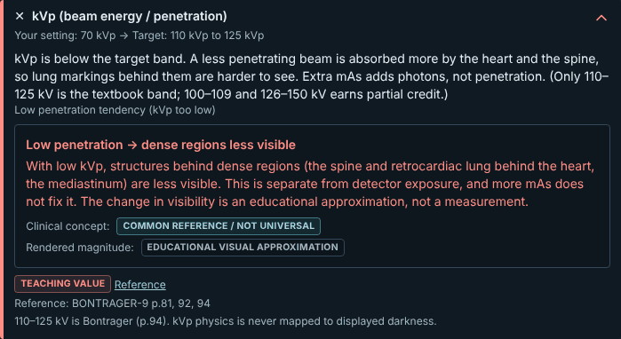
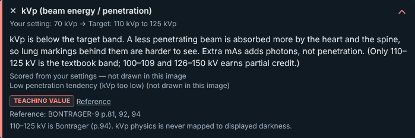

# RAD-098 — محرك صورة الأشعة، الجلسة 2، 2026-11-03

## 1. الانحرافات والميزانية

الميزانية المعلنة قبل التعديل: ≤12 ملفًا و≤4 وحدات منتج مشتركة. المستخدم: 12 ملفًا، ووحدة منتج واحدة (`plan.ts`)؛ لم يلزم `consistency.ts`.
الملفات: plan.ts، cross-family-pixels.test.ts، cross-family-test-utils.ts (اختبار فقط، أضيف لحفظ صفوف حد kVp بدل حذفها)، radiograph-pixel-witnesses.json، scene-dom/hashes.json، project-status.md، HANDOFF.md، هذا التقرير، فهرس التقارير (docs:sync)، ولقطتان مضغوطتان (40KB). حُذفت لقطة AR من الالتزام للبقاء ضمن 12؛ AR مُتحقق بـaxe وDOM (§6).
انحرافان معلنان: (1) توقعتُ قبل التعديل تغيّر الصفوف فقط في JSON الشهود، لكن حارس scene-dom تغيّر أيضًا لـ46 مفتاح Chest Lateral (الوسم نفسه، §4). (2) **الجزء B (D-R2) لم يُلتزم**: توقف بشرط المالك، وأعيد تعريف المرساة، ثم فشل شرط المرساة فعدنا إلى الخيار1 (§5).

## 2. المنجز والمستبعد

- **منجز (Draft):** الجزء A — العقد السببي D-R1 في التزام مستقل.
- **مؤجل بقرار المالك:** الجزء B — ضجيج التعريض المستمر؛ الرقعة المقترحة وأثرها المقيس محفوظان في §5.
- **خارج النطاق ولم يُلمس:** denseZones للأصول الثلاثة (الجلسة 2b)، قص القدم (3)، الهندسة (4)، الأصول، الدرجات، اختبارات جديدة، Assess/pilot، استمرارية الدوران.

## 3. لكل مهمة: RAD-098

تبقى planned وwaiting_on=owner: قرار مرساة D-R2 مطلوب قبل استئناف الجزء B. لا إغلاق ولا ready/merge؛ الدمج بعد إطلاق الخميس 2026-11-05.

## 4. الجزء A — العقد السببي والتغييرات المشتركة وScale

`plan.ts`: نقص الاختراق يُرسم فقط إذا أعلن الأصل `denseZones`؛ وإلا يُحذف الأثر من الخطة و`penetrationContrastKept=null`. فحص kVp يبقى مُحتسبًا كما هو، ويُظهر المسار القائم «مُحتسب من إعداداتك — غير مرسوم في هذه الصورة» (`needsNotDrawnLabel`)، ويصير المتغير «غير مرسوم».
لماذا البكسلات مطابقة: بلا مناطق كثيفة يكون وزن المنطقة 0، فخطوة الاختراق تساوي `img − 0` تمامًا؛ تخطيها ينتج البايتات نفسها حتى في الحالات المركبة.
الشهود: استبدلتُ التوقعات الثلاث للفجوة بعقد لكل فحص×أثر مرتبط بالنتيجة (rotation, inspiration, scapulae, chin, motion, low-exposure, excess-exposure, low-penetration): drawn=true ⇔ luma المعزولة تختلف عن الأساس، وdrawn=false ⇔ مطابقة. حدود معلنة: حقل/توسيط/حقل زائد تغيّر الهندسة مع أو بلا نتيجة، العلامة رمز توضيحي لا يُرسم في الشهود، والإسقاط لا يرسم شيئًا؛ تغطيها شواهد البوابات القائمة.
حد kVp يُحدَّد الآن بالنتيجة المحتسبة (`penetration==="low"`) لا بالأثر المرسوم، فبقيت صفوف threshold-low/before-low؛ للفحوص الـ14 ذات المناطق التعريفان متطابقان.

### جدول الشهود المتغيرة (9 من 1293؛ luma وsoloLuma مطابقة في كلها)

| السيناريو | القديم | الجديد | السبب |
|---|---|---|---|
| chest-lateral-erect / penetration/min | plan 975087dc · solo a8b790eb | plan fccb5f45 · solo 5be1dac2 | حذف low-penetration المزعوم؛ luma 5d0b3924 = |
| chest-lateral-erect / penetration/threshold-low | plan c92de384 · solo a8b790eb | plan 9cf4600c · solo 5be1dac2 | نفسه؛ luma 115a89cc = |
| chest-lateral-erect / combination | plan 2557bd69 | plan cd2c71cf | نفسه في المركب؛ luma 40a14584 = |
| pelvis-ap-supine / penetration/min | plan 8d7fc648 · solo ffe15574 | plan 4a93fb37 · solo 944be96d | نفسه؛ luma 0eb6f0b1 = |
| pelvis-ap-supine / penetration/threshold-low | plan 7d871bed · solo ffe15574 | plan 56104571 · solo 944be96d | نفسه؛ luma d8f5fddd = |
| pelvis-ap-supine / combination | plan cbbd0da8 | plan 31d0e648 | نفسه؛ luma 6516a824 = |
| shoulder-grashey-erect / penetration/min | plan b26f2598 · solo a6238977 | plan 562a6c73 · solo b817d0cc | نفسه؛ luma 788637c7 = |
| shoulder-grashey-erect / penetration/threshold-low | plan ea3ddfb5 · solo a6238977 | plan 07554157 · solo b817d0cc | نفسه؛ luma 12be6d0d = |
| shoulder-grashey-erect / combination | plan 09cf8c67 | plan 16b28520 | نفسه؛ luma 2a8bc3f1 = |

الحقول المتغيرة فقط: plan وsoloPlan وeffects. الخطة المعزولة الجديدة تساوي هاش soloPlan القديم لجارها غير المرسوم before-low (مثل 5be1dac2)، أي أنها صارت «غير مرسوم» حرفيًا.
**إثبات عدم التغير:** 1284 صفًا بايتًا ببايت، و2586 هاش luma كامل/معزول مطابقة في الفحوص الـ17. حُدِّث الملف بأداة تقارن كل صف وحقل وترفض أي فرق خارج القائمة المعلنة مسبقًا؛ لا إعادة توليد جماعية.
**scene-dom:** تغيّر 46 مفتاح `result|chest-lateral-erect|*` (EN/AR)، وبقي highKv والمشهد وPA وAP مطابقة. فرق الترميز: حذف بطاقة نقص الاختراق وعبارة «انخفاض الرؤية خلف القلب» من النص البديل، وdata-drawn=false، وإضافة وسم «غير مرسوم». النتيجة والدرجة والفحوص الأخرى مطابقة.
Scale: لا سقف جديد؛ الشرط يقرأ بيانات الأصل الاختيارية القائمة.

### قبل/بعد — Chest Lateral، kVp 70 (الإعداد الافتراضي)، 1440

| قبل (main) | بعد EN (AR: النص نفسه مترجمًا، مُتحقق بـDOM) |
|---|---|
|  |  |

## 5. الطب والدرجات — والجزء B المؤجل

Verified: الدرجات والأحكام والفحوص ونصوص EN/AR الأخرى بلا تغيير؛ Chest PA characterisation وgoldens مطابقة بعد الجزء A. لا قيم أو حقائق أو صور طبية جديدة.
**الجزء B، المحاولة 1 (مرساة EIT):** الرقعة جعلت `noiseSigma = sigmaPerUnit·√max(0, rel²−1)` و`detailGain = 1/(1+detailLoss·(rel²−1))` عندما rel>1، دون الاعتماد على مستوى الحكم. النتيجة: تغيّر 34 من 53 سيناريو Chest PA (plan.technique وrender.sha256 فقط)، ومنها `correct` عند rel 1.0659 (σ 0→3.32، gain 1→0.967) وkvp-70 عند rel 1.0038. والشهود 15 صفًا فقط، كلها `exposure/before-low` في 15 فحصًا، و1278 مطابقة. **STOP** وفق الشرط.
**قرار المالك (2026-11-03، في الجلسة):** لا قبول ولا تأجيل؛ اجعل المرساة تعريض المرجع الصحيح للحالة: عنده وفوقه صفر إضافي؛ تحته زيادة مستمرة بالعلاقة وTUNING القائمين فقط؛ وإن تغيّر `correct` أو احتاجت المرساة قيمة غير موجودة في البيانات فعُد إلى الخيار1.
**النتيجة:** المرجع الوحيد في بيانات المنتج هو `technique.manual.reference` (Chest PA 120kV/3.2mAs/180cm)، ونسبته 1.0 = الهدف نفسه، فتطابق المحاولة 1 ويبقى `correct` متغيرًا. إعداد `correct` (115kV يدوي) موجود فقط في تجهيزة QA `scripts/qa/scenarios.json`، وقراءتها من كود المنتج أو استعمال نطاقات DI محظوران. **فعُدنا إلى الخيار1: الجزء A فقط.**
الرقعة المقترحة (غير ملتزمة) في `buildRenderPlan`: استبدال `noisy ? … : 0` و`noisy ? … : 1` بالصيغتين أعلاه مع بقاء بطاقة low-exposure على `noisy`.

## 6. QA

| التصنيف | البند |
|---|---|
| Verified | CI unit (`CI=true CI_TEST_LANE=unit npm run check`): typecheck وlint (تحذيرا vb/inv السابقان فقط) و2564/2564 في 152 ملفًا، Node 22.23.4. |
| Verified | radiograph/exam/qa/evaluation: 1765/1765؛ cross-family شهود + العقد السببي للفحوص الـ17؛ characterisation وgoldens لـChest PA مطابقة. |
| Verified | `npm run build` و`build:pages`؛ health:source بلا أخطاء، health:sizes بلا أخطاء بعد build:pages، health:test ناجح. |
| Verified | exam-audit EN/AR × 390/1440 + axe WCAG2.1 A/AA لـchest-lateral-erect (وسم «غير مرسوم») وwrist-lateral (طرف، حالة تعريض منخفض مرسومة): 132 فحصًا، 0 إخفاق. |
| Verified | DOM في المتصفح: قبل = low-penetration في data-effects وdata-drawn=true وبطاقة؛ بعد = لا أثر وdata-drawn=false و6 وسوم «غير مرسوم» (كانت 5). |
| Verified | docs:sync مرتان بثبات، docs:check، status:check --base origin/main --require-previous، git diff --check. |
| Verified | أداء 390×844، Chromium، 3 إحماءات/9 عينات، الفرع مقابل main لـ17 فحصًا: لا تراجع >10%. أسوأ فرق Chest PA baseline +8.4% (39.1→42.4ms) بمدخلات رسم متطابقة بايتًا؛ دوران Chest PA 164.2→164.2. المدى −9.1%…+8.4%. |
| Inferred | فروق ±9% ضوضاء قياس؛ كود البكسل لم يتغير، والتغيير يتخطى خطوة صفرية فقط في 3 أصول عند kVp منخفض. |
| Not run | حالة الضجيج داخل النطاق في المتصفح ولقطاتها: الجزء B مؤجل. هاتف حقيقي ومراجعة طبية وCI البعيد بعد push. |

## 7. المفتوح

- قرار مرساة D-R2: أي تعريض «مرجعي صحيح» يجب أن يكون بيانات حالة (مثلًا إعداد مرجعي صحيح مُعلن لكل حالة)، أو قبول ضجيج خفيف في صورة Chest PA الصحيحة. رفع هذا يحتاج قرار مالك؛ لا ثابت جديد هنا.
- denseZones للأصول الثلاثة (2b) تحتاج مرجعًا ومراجعة؛ حتى ذلك يبقى نقص الاختراق «غير مرسوم» فيها (حد معلن، S-STD-3).
- النص البديل ما زال يقول «لا تغيّر ظاهر رغم زيادة التعريض» ضمن «النتائج الظاهرة» (سابق، خارج النطاق).

## 8. قائمة المالك وبرومبت الجلسة 3

1. راجع جدول §4 والقبل/البعد ووسم «غير مرسوم» في Lateral/Pelvis/Shoulder.
2. قرر مرساة D-R2 (§7) وسجّلها في DECISIONS عند radiograph-plan-owner-2026-11-03؛ الرقعة جاهزة للتطبيق بالمرساة المعتمدة.
3. تبقى PR مسودة؛ لا ready/merge قبل ما بعد الإطلاق.

**برومبت مسودة — الجلسة 3 (قص القدم):** اقرأ AGENTS وHANDOFF وRAD-098 وD-R1…D-R3 وتقريري الجلستين 1–2، وENGINE_GUIDE (الأدلة والدرجات والرسم)، وlimb-effects.ts وlower-limb-model، ومراجع Foot AP/Oblique. الهدف: إصلاح قص (shear) دوران القدم ضمن النموذج القائم، دون أصول أو مناطق أو قيم جديدة ودون تغيير الدرجات. أعلن الميزانية (≤12 ملفًا، ≤4 وحدات منتج) وقائمة الشهود المتوقع تغيرها (rotation/* لـfoot-ap وfoot-oblique فقط) قبل التعديل؛ أثبت بقاء الـ15 فحصًا الأخرى بايتًا ببايت بأداة القائمة المعلنة، وحدّث الشهود المسماة فقط مع تبرير لكل هاش. أبقِ العقد السببي D-R1 أخضر. لا استمرارية دوران أو هندسة (D-R3) أو denseZones. التحقق: اختبارات الأشعة/العائلة/المصفوفة، الشهود، Chest PA goldens/characterisation، typecheck/lint/health، build مرة، EN/AR 390/1440 + axe لـfoot-ap، قبل/بعد، أداء 390×844 (لا تراجع >10%). فرع جديد وDraft واحد؛ تقرير عربي S-STD-1.
