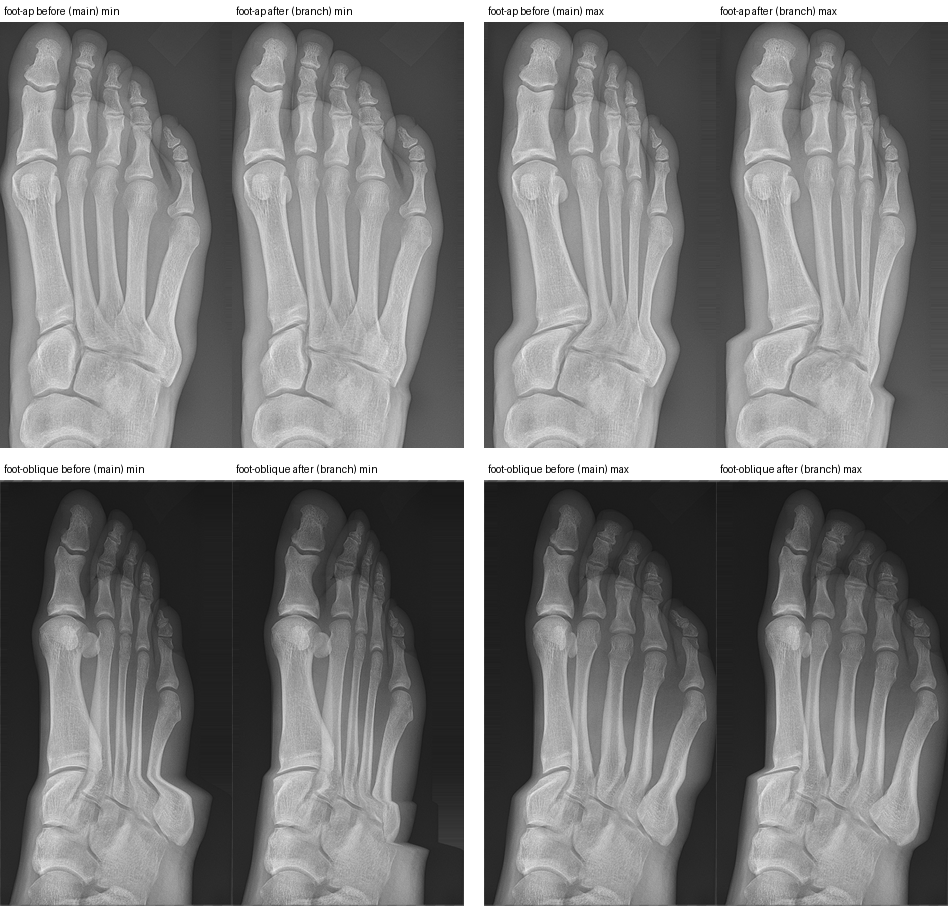

# RAD-098 — محرك صورة الأشعة، الجلسة 3b، 2026-11-04

## 1. الانحرافات والميزانية

الشرط المسبق: #226 (الجلسة 3) مدمجة في origin/main (Verified قبل البدء)؛ فرع جديد من origin/main وDraft واحد.
الميزانية المعلنة: ≤14 ملفًا و≤4 وحدات منتج. المستخدم: 14 ملفًا و3 وحدات منتج (`limb-effects.ts`، `messages/en.json`، `messages/ar.json`).
الملفات: DECISIONS، سجل الأصول، `limb-effects.ts`، `lower-limb-rotation.test.ts`، ملف الشهود، en/ar، `foot-oblique-hashes.json`، `run-matrix.mjs`، صورة الدليل، هذا التقرير، project-status، HANDOFF، فهرس التقارير.
انحرافات معلنة:
- **هاشات مشاهد foot-oblique (100 مفتاح `scene|`)** لم تكن في القائمة الأولى: الجملة المسموح بتغييرها تظهر في المشهد. أُثبت أنها السبب الوحيد: بنصوص main وكود الفرع تنجح اختبارات qa كلها (448/448)؛ مفاتيح `result|` الخمسون لم تتغير.
- **عكس دقيق للتشويه في صفوف القدم فقط** (`inverseWarp`) بدل التكرار الرباعي المشترك: التكرار لا يتقارب حيث تختلف إزاحات الأشعة المتجاورة كثيرًا (خطأ حتى 0.039 من العرض عند قاعدة المشط 5 المائل)، فلا يبقى الشعاع صلبًا. أثره داخل الصفوف العشرة المعلنة فقط.
- أداتا QA شُغّلتا بنسخ مؤقتة خارج المستودع: `lower-limb-audit.mjs` (محدد الدرجة القديم نفسه) و`radiograph-performance.mjs` (يتوقف إذا اختلفت بكسلات main/الفرع؛ هنا الاختلاف متوقع لـrotation/max فقط، وبقي شرط التطابق للـbaseline). لم يُعدَّل أي منهما.
- ENGINE_GUIDE بند 6 («القص حد للنموذج لم يتغير هنا») صار قديمًا جزئيًا؛ لم يُعدَّل للبقاء ضمن الميزانية (§7).

## 2. المنجز والمستبعد

- **منجز (Draft):** قرارات المالك الثلاثة في DECISIONS وصف «Result-image use» في سجل الأصول (الالتزام الأول)؛ الإصلاح الصلب لأشعة القدم؛ تحديث فحوص run-matrix؛ تشخيص clip-margin-only.
- **لم يُلتقط:** `clip-margin-only` — السبب منطق منتج (§6.2)، فلا يسمح القرار 2 بإعادة الالتقاط.
- **خارج النطاق ولم يُلمس:** الأصول والمناطق والقيم الطبية والدرجات والأحكام والفحوص، استمرارية الدوران، الهندسة (D-R3)، denseZones، رسم الإعداد.

## 3. لكل مهمة: RAD-098

تبقى planned وwaiting_on=owner: مراجعة الـDraft وقرارات §7. لا ready/merge.

## 4. التغييرات المشتركة وScale

- `limb-effects.ts`: `deriveFootRays` (اشتقاق نقي عند التحميل من `foot-outlines.json`، لا أرقام مخزنة)، `footRayAnchors` (مرساة لكل شعاع على خطه في كل صف)، `inverseWarp`، وفرع القدم في `prepareLimbRow`. الخطة (`limbRotationPlan`) لم تتغير، فهاشات الخطط في الشهود ثابتة.
- `run-matrix.mjs`: محددات فقط (الدرجة، عنوان الحكم ومنه «خطأ حرج»، ملاحظة الخطأ الحرج، بطاقات التأثير كمجموعة، عدد ملاحظات الهامش حسب اللوحة الحالية). لا تغيير في السماح أو الالتقاط.
- حجم الصفحات (gzip، build:pages): +537 بايت لصفحات practice الـ38، و+52 لـ54 صفحة أخرى؛ الأكبر 492,930 بايت (481.4 KiB من 500).
- Scale: لا سقف جديد غير قيد الطي في §5.

## 5. الطب والدرجات — أشعة القدم الصلبة

**الاشتقاق (قرار المالك (أ)):** خط الشعاع n هو ملاءمة المربعات الصغرى x = a + b·y لرؤوس مخطط `mt{n}` وسلامياته؛ حافة قاعدته أكبر y في مخطط `mt{n}`. توضيحي، ليس قياسًا.
الحواف (px): AP 1297، 1390، 1418، 1460، 1531؛ المائل 1315، 1404، 1393، 1442، 1652. يرمي الاشتقاق خطأ إن غاب مشط أو سلامى (شرط التوقف، مختبر).
**الحركة:** كل شعاع مع أصابعه يتحرك بإزاحة واحدة (إزاحة المشط في النموذج القائم) حتى حافة قاعدته، ثم تتلاشى إلى صفر خلال `bandSoft` بعد الحافة (خارج العظم). صفوف الرصغ بعد ذلك لا تتحرك.
**قبل/بعد (الرأس/القاعدة، px):** المائل 25° المشط 5: −149/0 → −149/−119؛ AP +15 المشط 5: −75/0 → −75/−70 (القاعدتان بعد قيد الطي أدناه)؛ بقية المحطات صلبة تمامًا (الاختبار يفحص كل محطة وكل صف ثانٍ).
**حد معلن (قيد الطي):** حين تمرّ قاعدة المشط 5 فوق خط الشعاع 4 الثابت لا يرسم تشويه أحادي القيمة التراكب، فيمسكها `monotone`: حتى 30 px في المائل 0–25° (القيمة مقيدة عند 25°)، و18 عند 26°، و6 عند 27°، و5 في AP +15؛ فقط في آخر 180 صفًا من المشط 5 (مثبت بالاختبار). رفعه = قرار مالك برسم تراكب بطبقتين.
**حد معلن:** يتدرج الخط الخارجي للنسيج الرخو عند حافة قاعدة الشعاع الطرفي (كان مثله عند حافة الشريط القديمة)، والمواضع بين الأشعة تُستوفى خطيًا.

**الشهود (أداة القائمة):** 1293 صفًا؛ تغيّر العشرة المعلنة فقط (luma وsoloLuma؛ الخطط مطابقة)، والـ1283 الباقية مطابقة بايتًا. القديم→الجديد: foot-ap min a0d4dc1e→7103b4d9، max 24e86e9f→0e01c7fb، threshold-low 654cdc98→55fcc1ca، threshold-high c41adc3d→ab939123، combination 3a35ced4→400e321f؛ foot-oblique min 2f5b3d85→337279a5، max bdb329f2→ebacb804، threshold-low f7021f1f→78c44da8، threshold-high 817c11db→6e413a78، combination 1e122ba6→e0971d3f.
**النص (التغيير الوحيد):** EN قديم: «The result image approximates bone movement with a warp, so the 5th metatarsal may look sheared at large rotations; the set-up drawing shows it moving rigidly.» جديد: «The result image moves each metatarsal with its toes as one rigid piece and keeps the tarsals still; at the smallest angles the base of the 5th metatarsal is held back slightly, because one image cannot show it overlapping.»
AR قديم: «تقرّب صورة النتيجة حركة العظام بتشويه (warp)، فقد يبدو المشط الخامس مقصوصًا عند الدوران الكبير؛ بينما يُظهره رسم الإعداد يتحرك صلبًا.» جديد: «تحرّك صورة النتيجة كل عظم من مشط القدم مع أصابعه قطعةً واحدة صلبة وتُبقي عظام الرصغ ثابتة؛ وعند أصغر الزوايا تُمسَك قاعدة المشط الخامس قليلًا، لأن الصورة الواحدة لا تستطيع إظهار تراكبها.» (العربية مسودة آلية.)
Verified: لا تغيير في الدرجات أو الأحكام أو الفحوص أو النص البديل أو قيم النموذج؛ لا أصول أو مناطق جديدة.

## 6. QA

| التصنيف | البند |
|---|---|
| Verified | CI unit (`CI=true CI_TEST_LANE=unit npm run check`): typecheck، lint (0 أخطاء وتحذيرا vb/inv السابقان)، 2571/2571 في 152 ملفًا، ومنها الشهود والعقد السببي D-R1 وهوية النطاق وChest PA characterisation/goldens وscenario-matrix، واختبارات الأشعة الجديدة. |
| Verified | أداة القائمة على الشهود: 10 صفوف معلنة فقط، الباقي مطابق (§5). |
| Verified | `npm run build` مرة، ثم build:pages للحجم؛ health:source وhealth:test (9/9) وhealth:sizes بلا أخطاء. |
| Verified | foot-ap وfoot-oblique: EN/AR × 1440/390، axe على المركز والإعداد والنتيجتين، بلا تجاوز أفقي؛ كل الفحوص ناجحة (نسخة مؤقتة بمحدد الدرجة الحالي). |
| Verified | الأداء 390×844 (Chromium، AB/BA، وسيط ms) مع إعادة قياس مزدوجة، §6.1: لا تراجع. |
| Verified | marker على main والفرع مطابق: `pilot-v1:1cf8168ea71a996807ccae15b9ca0b780d86b7ab5852c3e476b119a6345e1910` (عنوان Supabase عام اصطناعي). |
| Verified | run-matrix كاملًا (53 سيناريو، EN+AR، الأجهزة الثلاثة) على build من main: يكتمل، 3147/3149؛ الفشلان مقارنة clip-margin-only (§6.2). |
| Verified | docs:sync مرتان (الثانية بلا تغيير)، docs:check، status:check --base origin/main --require-previous، git diff --check. |
| Inferred | رسم الإعداد لم يتغير (لا ملف رسم معدّل؛ هاشات نتائج foot-oblique الخمسون ثابتة). |
| Not run | هاتف حقيقي، مراجعة طبية/تعليمية، CI البعيد بعد push (يعمل عند فتح Draft). |

### 6.1 الأداء (main → الفرع، ms)

| الفحص | baseline | rotation/max | إعادة: baseline | إعادة: rotation/max |
|---|---|---|---|---|
| foot-ap | 92.2 → 86.5 | 295.8 → 120.9 | 83.3 → 84.8 | 253.9 → 104.1 |
| foot-oblique | 81.9 → 79.9 | 254.8 → 104.5 | 86.0 → 87.7 | 245.3 → 97.5 |

الـbaseline كود متطابق (فرق ضجيج ≤±7%)؛ الدوران أسرع لأن العكس الدقيق يحل محل أربع تكرارات.

### 6.2 clip-margin-only — السبب

- **متى:** الصورة التُقطت 2026-10-06 (e003d96) ولم تُلتقط بعدها. هاش الفانتوم في `matrix.json` لهذا السيناريو `dad1b1b1…` لم يتغير منذ ذلك اليوم: خط البكسل نفسه لم يتغير.
- **أين:** كل البكسلات المخالفة في صف حافة الحقل الأفقية فقط (الصفان 41–42؛ داخل الصورة فرق المتوسط 0.02). كل صورة أخرى لها الإزاحة نفسها في صف واحد (badFraction 0.00182 لـcorrect وأمثالها، تحت 0.002)؛ هنا تقع الحافة على صفين فتصير 0.00224.
- **لماذا:** fce75bc (2026-10-25، RAD-080، «preserve centimetre inputs») جعل منزلقات المركز والحقل تحفظ السنتيمترات بلا تقريب إلى ثلاث خانات؛ 18.5 سم كانت −0.140 وصارت −0.139535 (≈0.01 سم، ≈0.12 px بعد التصغير).
- **الإثبات:** رسم Node لكود main الحالي بالتقريب القديم يطابق الصورة الملتزمة في صفوف الحافة (25.31/98.50 مقابل 25.45/98.62)، وبالتحويل الحالي يطابق المتصفح الآن (13.76/90.60 مقابل 13.91/90.73؛ correct: 86.94/13.43 مطابق). الصفوف الأخرى المختلفة (133–152) هي حرف العلامة الذي يرسمه المتصفح فقط.
- **الحكم:** حميد ومقصود، لكنه منطق منتج (تحويل مدخلات التحكم)، والبيئة ليست السبب. لم يُعَد الالتقاط ولم يتغير أي سماح.

## 7. المفتوح

- **رسم الإعداد والصورة في الأصابع (قرار مالك):** الرسم (لم يتغير) يحرك كل إصبع بمراسي الأصابع، والصورة تحركه مع مشطه. الفرق حتى 31 px (AP) و43 px (المائل)، وباتجاه معاكس في 15 حالة AP و26 حالة مائل عند قيم صغيرة (مثلًا المائل 28° الشعاع 2: مرساة الإصبع 0 والمشط +33 px). الخيارات: تحريك أصابع الرسم مع المشط، أو قبول الفرق وتسميته.
- **clip-margin-only:** إعادة الالتقاط تحتاج قرار مالك صريحًا لأن السبب منطق منتج (§6.2)؛ وتحتاج الصور الأخرى الشيء نفسه إن أراد المالك هامشًا أكبر.
- قيد الطي للمشط 5 (§5)، وتدرج النسيج الرخو عند الحافة.
- ENGINE_GUIDE بند 6 وتعليق `foot-outline-drawing.ts` يصفان القص كحد قائم؛ يحتاجان تحديثًا في دفعة توثيق.
- `lower-limb-audit.mjs` و`radiograph-performance.mjs` فيهما محدد درجة قديم وشرط تطابق لا يناسب تغييرًا مقصودًا (S-STD-3: أدوات QA يدوية خارج CI).

## 8. قائمة المالك وبرومبت الجلسة التالية

1. راجع صورة قبل/بعد و§5 (الحواف، قيد الطي، النص الجديد EN/AR).
2. قرر §7: أصابع الرسم، وclip-margin-only.
3. تبقى Draft؛ لا ready/merge.

**برومبت مسودة — الجلسة 4:** اقرأ AGENTS وHANDOFF وRAD-098 وقرارات المالك في §7 من هذا التقرير. نفّذ ما قرره المالك فقط (أصابع الرسم/clip-margin-only) ثم denseZones والجلسة 4 ضمن D-R1–D-R3؛ كل تغيير بكسل بقائمة صفوف معلنة وأداة ترفض غيرها. فرع جديد وDraft واحد.
