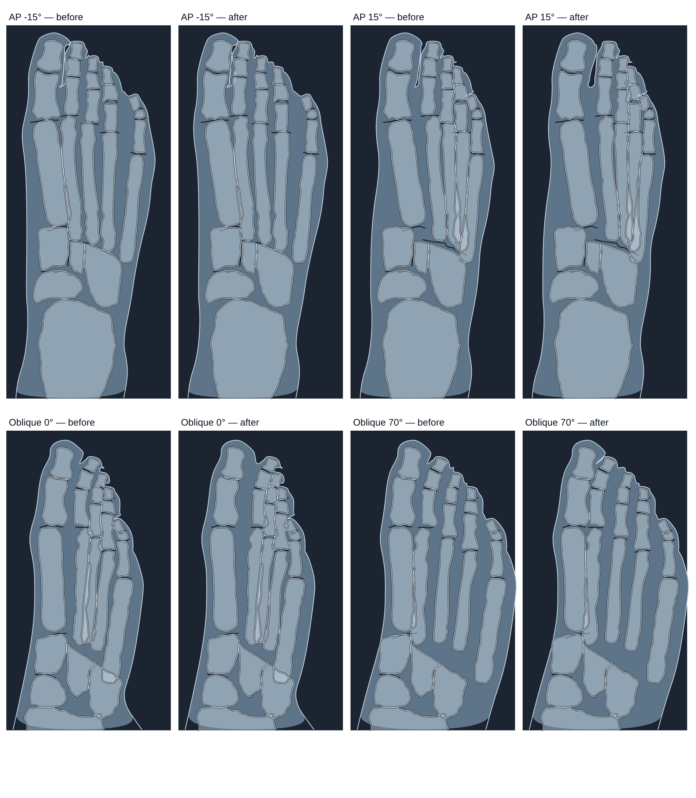

# RAD-098 — محرك صورة الأشعة، الجلسة 3c، 2026-11-04

## 1. الانحرافات والميزانية

الشرط المسبق: #228 (الجلسة 3b) مدمجة في origin/main (Verified قبل البدء)؛ فرع جديد من origin/main وDraft واحد. لم يُلمس `src/data/cases/*` ولا ملف الشهود.
الميزانية المعلنة: ≤12 ملفًا و≤2 وحدة منتج. المستخدم: 17 ملفًا و3 وحدات منتج.
ملفات العمل (12): DECISIONS، ENGINE_GUIDE، `foot-outline-drawing.ts`، اختباره، `LowerLimbFigure.tsx` (تعليق فقط)، `lower-limb-visual.ts` (حذف فقط)، `foot-ap-hashes.json`، `foot-oblique-hashes.json`، `clip-margin-only.png`، `golden-image-checksums.json`، `lower-limb-audit.mjs`، `radiograph-performance.mjs`.
ملفات التسليم (5): هذا التقرير، project-status، HANDOFF، فهرس التقارير، صورة قبل/بعد.
انحرافات معلنة:
- **وحدة منتج ثالثة:** `lower-limb-visual.ts`: حُذفت `footShiftPx` لأنها صارت بلا مستدعٍ بعد المهمة A (خطأ knip في health:source). حذف فقط، بلا سلوك جديد.
- **تجاوز عدد الملفات (17 بدل 12):** قائمة المالك نفسها 11 ملفًا؛ أُضيف الحذف السابق وملفات التسليم الخمسة. لم يُحذف بند تسليم لتقليل العدد.
- **إزاحة المشط في الرسم تغيّرت أيضًا** (حتى 13.4 px في AP و4.2 في المائل): كان الرسم يقرأ إزاحة المشط بأوزان الشرائط عند مركز العظم، وهذا «نموذج ثانٍ». صار الشعاع كله (المشط وإصبعه) يتحرك بإزاحة الشعاع نفسها التي تستخدمها الصورة (§5).
- **البناء مرتين:** الأول سبق الحذف أعلاه، فأُعيد check والبناء مرة واحدة بعده؛ ثم build:pages للحجم بعد إغلاق QA.

## 2. المنجز والمستبعد

- **منجز (Draft):** قرارات المالك 4–6 تحت المرساة القائمة (الالتزام الأول)؛ A أصابع رسم الإعداد؛ B إعادة التقاط clip-margin-only؛ C بند ENGINE_GUIDE 6؛ D أداتا QA.
- **لم يتغير:** النص المساعد EN/AR (بقي صحيحًا)، مفاتيح `result|`، الشهود، الدرجات، الأحكام، السماحات، بقية الصور الذهبية الـ52.
- **خارج النطاق:** denseZones (جلسة موازية)، الهندسة، الأصول، المناطق، القيم الطبية.

## 3. لكل مهمة: RAD-098

تبقى planned وwaiting_on=owner: مراجعة الـDraft. لا ready/merge.

## 4. التغييرات المشتركة وScale

- `foot-outline-drawing.ts`: `footRigidShifts` تعيد لكل شعاع n القيمة `footAnchors(kind, footValue(kind, deg)).metatarsal[n−1].du × العرض` للمفتاحين `mt{n}` و`t{n}`، وهي نطاق الخطة 2 الذي يقرؤه `footRayAnchors` في الصورة. لا أرقام جديدة ولا نموذج ثانٍ. المفصل MTP يتبع الشعاع نفسه؛ خطوط TMT والرصغ كما كانت.
- `LowerLimbFigure.tsx`: تعليق الرأس فقط (كان يصف الإزاحة الموزونة بالشرائط).
- `lower-limb-audit.mjs`: محدد الدرجة الحالي (`span[dir="ltr"]`، كما في run-matrix). `radiograph-performance.mjs`: خيار `--allow-differ exam/scenario` لتغيير مقصود، يُسجَّل في الناتج (`mainBranchPixelsEqual`)؛ أي فرق غير معلن يبقى STOP.
- ENGINE_GUIDE بند 6: الأشعة الصلبة (3b/3c) والحدان المعلنان (إمساك قاعدة المشط 5، تدرج النسيج الرخو)؛ حُذفت عبارة «القص حد لم يتغير».
- Scale: لا سقف جديد. الحد القائم: إمساك قاعدة المشط 5 (رفعه بقرار مالك برسم تراكب بطبقتين).

## 5. الطب والدرجات — أصابع رسم الإعداد

**قبل:** الإصبع بمراسي الأصابع والمشط بمراسي المشط، كلاهما بأوزان الشرائط عند مركز العظم؛ الفرق بين الإصبع ومشطه حتى 33.9 px (AP) و40.6 px (المائل)، وباتجاهين متعاكسين في 11 حالة AP و27 حالة مائل من محطات الوحدة.
**بعد:** الفرق 0 في كل محطة (AP −15…15، المائل 0…70°). الشعاع كله يساوي إزاحة الصورة.
**الاختبار:** «moves each toe with its metatarsal by the result image's own ray shift at every console station»: في كل محطة يساوي انتقال `mt{n}` قيمة `limbRotationPlan(...).hand.anchors[1][n−1].du × العرض`، ويساوي انتقال كل بنية `t{n}-*` انتقال `mt{n}`. اختبارات الصلابة والرؤية والطي والمرآة بقيت كما هي وتنجح.

**ملاحظة بصرية:** عند AP +15 تتقارب أصابع الأشعة 3–5 وتتراكب جزئيًا مع مشطها، كما في الصورة. الرسم لا يرسم حدّي الصورة المعلنين.
**الهاشات:** foot-ap: 96 من 100 مفتاح `scene|` (الحالة rot40 ثابتة: الحالة الابتدائية لهذه الحالة إسقاط مائل عند 40°، أي وضع الأساس)؛ foot-oblique: 100 من 100. كل مفاتيح `result|` الخمسين لكل فحص ثابتة. أعيد التوليد بـ`UPDATE_LOWER_LIMB_HASHES=foot-ap` ثم `=foot-oblique`، بلا تعديل يدوي.
Verified: لا تغيير في الدرجات أو الأحكام أو الفحوص أو القيم أو بكسلات الصورة؛ ملفات هاشات المشاهد الأخرى وملف الشهود لم تتغير.

## 6. QA

| التصنيف | البند |
|---|---|
| Verified | CI unit (`CI=true CI_TEST_LANE=unit npm run check`) بعد آخر تغيير منتج: typecheck، lint (0 أخطاء، والتحذيران السابقان vb/inv)، 2578/2578 في 153 ملفًا، ومنها الشهود والعقد السببي وهاشات المشاهد كلها وgoldens Chest PA. |
| Verified | `npm run build` مرة بعد آخر تغيير (§1)؛ health:source بلا أخطاء (بعد الحذف)، health:test 9/9، health:sizes (§6.1). |
| Verified | `lower-limb-audit.mjs` لـfoot-ap وfoot-oblique: EN/AR × 1440/390، axe على المركز والإعداد والنتيجة، بلا تجاوز أفقي، الدرجة 100 بالمحدد الجديد؛ «all knee / foot checks passed». |
| Verified | `radiograph-performance.mjs` في نسخة مؤقتة خارج المستودع، الأساس فيها main قبل 3b (c4b9db3) لإنتاج فرق مقصود: بلا تصريح يتوقف «STOP: foot-ap/rotation/max»؛ مع `--allow-differ` لصفي القدم يكتمل لـ17 فحصًا (68 صفًا، المختلفان فقط foot-ap/foot-oblique rotation/max). |
| Verified | clip-margin-only: `--update-goldens --only=clip-margin-only` (EN، سطح المكتب، 21/21)؛ sha256 للصور الـ53 قبل/بعد: تغير هذا الملف وحده. السطر الوحيد في `golden-image-checksums.json` حُدّث، واختبارات qa 448/448. |
| Verified | run-matrix كاملًا (53 سيناريو، EN+AR، الأجهزة الثلاثة) على build الفرع: 3149/3149، بلا فشل (كانت 3147/3149 في 3b بسبب clip-margin-only). |
| Verified | marker على main والفرع مطابق: `pilot-v1:1cf8168ea71a996807ccae15b9ca0b780d86b7ab5852c3e476b119a6345e1910` (عنوان Supabase عام اصطناعي). |
| Verified | صورة قبل/بعد من `OutlineLayers` نفسه بكود main وكود الفرع عند أدنى وأقصى دوران. |
| Verified | docs:sync مرتان (الثانية بلا تغيير)، docs:check، status:check --base origin/main --require-previous، git diff --check. |
| Not run | هاتف حقيقي، مراجعة طبية/تعليمية، CI البعيد (يعمل عند فتح Draft)، قياس أداء الرسم (لا تغيير في الصورة). |

### 6.1 الحجم

build:pages ثم health:sizes بلا أخطاء: 94 صفحة، الأكبر `en/xray/wrist-pa/practice.html` 491,365 بايت gzip (479.8 KiB من 500)؛ كان 492,930 في 3b (−1,565 بايت بعد حذف `footShiftPx` وتبسيط الرسم). الصورة الجديدة في docs/review مسجلة قياسًا فقط.

## 7. المفتوح

- حدّا الصورة المعلنان (إمساك قاعدة المشط 5 عند أصغر الزوايا، تدرج النسيج الرخو عند حافة القاعدة) باقيان؛ رفع الأول بقرار مالك برسم تراكب بطبقتين.
- denseZones والجلسة التالية كما في الخطة.

## 8. قائمة المالك وبرومبت الجلسة التالية

1. راجع صورة قبل/بعد (§5) وانحرافات الميزانية (§1).
2. تبقى Draft؛ لا ready/merge.

**برومبت مسودة — التالي:** اقرأ AGENTS وHANDOFF وRAD-098 وهذا التقرير. نفّذ denseZones ضمن D-R1–D-R3 وقرارات المالك القائمة فقط؛ كل تغيير بكسل بقائمة صفوف معلنة وأداة ترفض غيرها. فرع جديد وDraft واحد.
