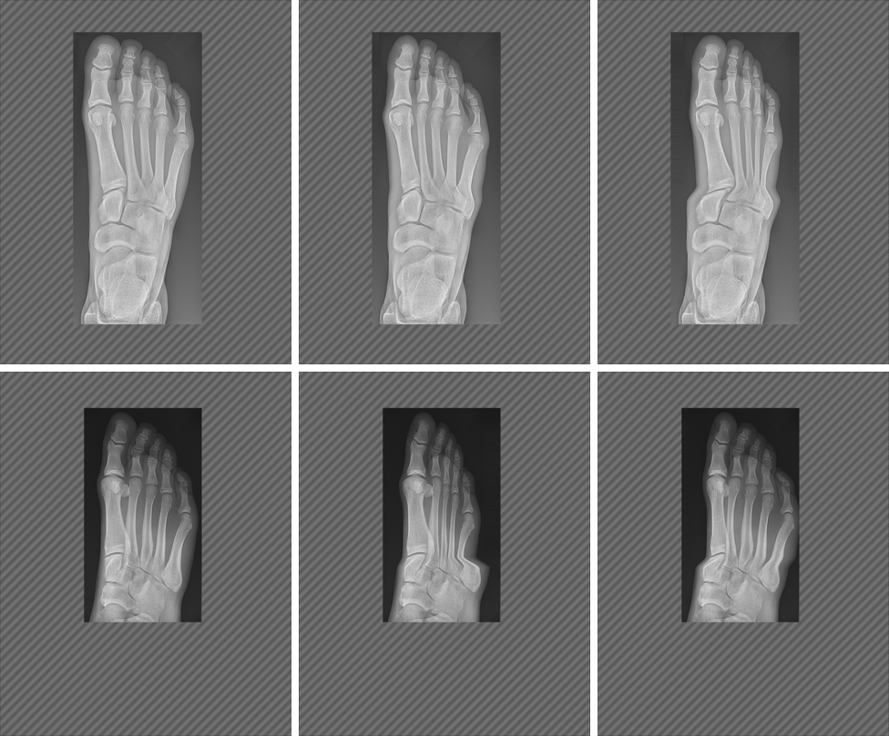

# RAD-098 — محرك صورة الأشعة، الجلسة 3، 2026-11-03

## 1. الانحرافات والميزانية

الميزانية المعلنة قبل التعديل: ≤12 ملفًا و≤4 وحدات منتج. المستخدم: 12 ملفًا، وصفر وحدات منتج.
الملفات: 6 صور golden، golden-image-checksums.json، هذا التقرير، لقطة الدليل (145KB)، project-status.md، HANDOFF.md، فهرس التقارير (docs:sync).
انحرافات معلنة:
- **الجزء B توقف بشرط المالك** قبل أي تعديل منتج: العيب مثبت، لكن إصلاحه يحتاج قيمة غير موجودة في البيانات (§5).
- سكربت الالتقاط `run-matrix.mjs` قديم مقابل الواجهة: فحوص نصية (الدرجة، وسم النجاح، السبب الحرج) تنتظر محددات لم تعد موجودة فيتوقف. لم أعدّله؛ شغّلت نسخة مؤقتة خارج المستودع (§4).

## 2. المنجز والمستبعد

- **منجز (Draft):** الجزء A — إعادة التقاط صور golden الست فقط، في التزام مستقل.
- **متوقف:** الجزء B — قص دوران القدم؛ لم يُعدَّل كود منتج أو شاهد.
- **خارج النطاق ولم يُلمس:** استمرارية الدوران، الهندسة (D-R3)، denseZones، الأصول، الدرجات، EN/AR، النص البديل.

## 3. لكل مهمة: RAD-098

#225 (الجلسة 2b) مدمجة في origin/main (Verified قبل البدء). تبقى RAD-098 planned وwaiting_on=owner: قرار المالك في مصدر حواف القدم (§7). لا ready/merge.

## 4. الجزء A — التقاط الصور الست والتغييرات المشتركة وScale

الطريقة: build إنتاجي من origin/main، ثم الواجهة الحقيقية (desktop/EN، canvas مصغّر ×2، كما يفعل `run-matrix.mjs --update-goldens`) في مجلد معزول خارج المستودع.
النسخة المؤقتة تغيّر أمرين فقط: مهلة 3 ثوانٍ للفحوص النصية القديمة، وقائمة سماح ترفض الكتابة لأي سيناريو خارج الستة. لا تمس مسار البكسل.
أداة تثبيت تنسخ الملفات الستة فقط وتحدّث مداخلها الستة فقط، وترفض أي ملف أو checksum آخر يختلف.
**إثبات أمانة الالتقاط (قبل):** مقارنة الـ53 بالصور الملتزمة: فشلت الستة المسماة، ونجحت 46 أخرى ضمن السماح، وفشل `clip-margin-only` بفارق ضئيل (§7).

| الصورة | checksum قديم→جديد | meanAbs قبل الالتقاط |
|---|---|---|
| mas-low | aa5a9213→d61a5c01 | 1.19 |
| mas-very-low | cbad6ebf→df778f27 | 1.49 |
| kvp-105 | 25ddbb9a→c4988faa | 1.28 |
| sid-200 | 240abfcf→d0cd5a05 | 1.40 |
| combo-low-kvp-low-mas | e312019f→eaf2316c | 2.03 |
| combo-all-wrong | 0e2e5959→dbe8471d | 0.98 |

التبرير لكل صورة: سيناريو تحت النطاق تغيّر ضجيجه في 2b (هاشات render/matrix في [تقرير 2b](RAD-098_RADIOGRAPH_SESSION2B_2026-11-03.md#chest-pa--كل-السيناريوهات-المتغيرة-6-من-53)).
**إثبات عدم التغير:** `git diff origin/main` يقتصر على الصور الست وستة أسطر checksum؛ matrix.json وchest-pa-scenarios.json وchest-pa-case.json والصور الـ47 الأخرى مطابقة بايتًا.
Scale: لا سقف جديد.

## 5. الطب والدرجات — الجزء B (قص القدم): العيب مثبت والإصلاح متوقف

**ماذا تفعل الصورة الآن:** الإزاحة لكل صف = وزن النطاق × إزاحة العمود (`prepareLimbRow` ← `warpColumnsShiftU`، حدود من `FOOT_*_DISPLACEMENT` وأعمدة من `footAnchors`).
نطاق المشطيات ينتهي عند حافة أفقية (AP الصف 1330، المائل 1411؛ حافة ناعمة ±0.03). صفوف ما بعدها (الرصغ) لا تتحرك.
قواعد المشطيات المتتبعة تتجاوز الحافة (AP: المشط 3–5 حتى 1418–1531؛ المائل: 4–5 حتى 1442–1652). يتحرك رأس العظم كاملًا وقاعدته صفرًا، والانتقال كله في ~120 صفًا وسط الجسم: عظم منثنٍ.

| الإسقاط (قيمة الشاشة) | العظم | إزاحة الرأس / القاعدة (px) |
|---|---|---|
| المائل 25° (−15) | المشط 5 / 4 / 3 | −149/0؛ −96/−10؛ −36/−6 |
| AP +15 | المشط 5 / 2 / 3 | −75/0؛ 60/2؛ 37/0 |
| AP −15 | المشط 4 / 3 | −53/0؛ −46/0 |

حُسبت من الدوال القائمة على نقاط المخططات المعتمدة؛ وتطابق تشخيص [#13 في 2b المرحلة A](../2026-10/RAD-072_PART2B_PHASE_A_REPORT_2026-10-23.md) (المشط 5 المائل −149/0).
**ماذا يقول المرجع:** Bontrager ص.232–233 يصف الدوران بتغير تباعد وتراكب المشطيات (2–5 في AP، 3–5 في المائل)، بعظام كاملة لا تنثني. الرسم يحرّك كل عظم صلبًا ([ENGINE_GUIDE بند 6](../../../ENGINE_GUIDE.md#limb-drawing-style-rad-072-2a-hand-pilot-2b-wrist-and-foot))، والصورة لا.
**الشهود التي تُظهره:** foot-ap وfoot-oblique: rotation/min وmax وthreshold-low وthreshold-high وcombination (10 صفوف). before-low/high غير نشطة.

**لماذا توقفت:** خط المفاصل الرصغية المشطية مائل (AP: المسماري الإنسي يبدأ 1294 والمشط 5 ينتهي 1531)، فلا حافة أفقية تفصل المشطيات عن الرصغ. الإصلاح الصلب يحتاج حافة قاعدة لكل شعاع، غير موجودة في النموذج أو بيانات الأصل.
المصدر الوحيد لها `foot-outlines.json`، وسجله «للرسم فقط؛ صور النتيجة بلا تغيير» ([الأصول](../../../ASSET_PROVENANCE_AND_LICENSES.md)). استعماله في الصورة يغيّر الاستخدام المسجل: قرار مالك. تحريك الرصغ يحتاج أعماقًا مختلقة.
Verified: لا تغيير في الدرجات أو الأحكام أو الفحوص أو EN/AR أو النص البديل؛ لا كود منتج متغير.

## 6. QA

| التصنيف | البند |
|---|---|
| Verified | CI unit (`CI=true CI_TEST_LANE=unit npm run check`): typecheck وlint وكل الاختبارات، ومنها الشهود للفحوص الـ17 والعقد السببي D-R1 وهوية النطاق D-R2 المعدّل؛ النتيجة في §6.1. |
| Verified | Chest PA characterisation وscenario-matrix: 335/335 بعد الالتقاط. |
| Verified | الواجهة بعد الالتقاط: الـ53 مقابل الصور الملتزمة، ولا يفشل غير `clip-margin-only` السابق (§6.1). |
| Verified | `npm run build` مرة واحدة؛ health:source وhealth:test؛ health:sizes بعد build:pages. |
| Verified | marker على main والفرع مطابق: `pilot-v1:f169745fbc7b7578811bec83d168816dea2a9b043cb03d95814124341e0bf371` (عنوان Supabase عام اصطناعي). |
| Verified | docs:sync مرتان بثبات، docs:check، status:check --base origin/main --require-previous، git diff --check. |
| Not run | EN/AR 390/1440 + axe لـfoot-ap/foot-oblique، صورة بعد، أداء 390×844: لا تغيير منتج بعد توقف B؛ لا شيء جديد يُقاس. |
| Not run | الفحوص النصية القديمة في run-matrix (محددات قديمة، سابقة)، هاتف حقيقي، مراجعة طبية، CI البعيد بعد push. |

### 6.1 نتائج التشغيل

- check: typecheck، lint (0 أخطاء وتحذيرا vb/inv السابقان)، 2564/2564 في 152 ملفًا، Node 22.23.4.
- golden عبر الواجهة: قبل الالتقاط 46/53 صورة مطابقة (الستة + clip-margin-only)؛ بعده 52/53 (clip-margin-only فقط). باقي إخفاقات السكربت فحوص نصية بمحددات قديمة، متطابقة قبل وبعد.
- build ثم build:pages (لازم لـhealth:sizes)؛ health:sizes بلا أخطاء، health:source بلا أخطاء، health:test 9/9.

## 7. المفتوح

- **مصدر حواف القدم (قرار مالك):** (أ) السماح باشتقاق حافة قاعدة لكل شعاع من `foot-outlines.json` المعتمد للصورة أيضًا؛ (ب) حواف جديدة بالعين لكل شعاع (توضيحية، فئة O62)؛ (ج) إبقاء الحد وتسميته. رفع التوقف = اختيار (أ) أو (ب).
- نص مساعدة المائل يسمّي القص («may look sheared»)، ونص AP لا يسميه؛ تغيير النص خارج النطاق.
- `clip-margin-only`: badFraction 0.00224 مقابل حد 0.002 (meanAbs 0.06)، داخل النطاق وغير متأثر بـ2b؛ خارج القائمة المعتمدة فلم يُلتقط.
- `run-matrix.mjs` يحتاج تحديث محدداته النصية (S-STD-3: أداة QA يدوية، ليست في CI).

## 8. قائمة المالك وبرومبت الجلسة التالية

1. راجع الصور الست (diff الالتزام الأول) وجدول §4.
2. راجع جدول §5 ولقطة الدليل، واختر (أ) أو (ب) أو (ج) في §7، وسجّله في DECISIONS.
3. قرر `clip-margin-only` وتحديث محددات run-matrix. تبقى Draft؛ لا ready/merge.

**برومبت مسودة — الجلسة 3b:** اقرأ AGENTS وHANDOFF وRAD-098 وقرار المالك في حواف القدم وهذا التقرير. نفّذ الإصلاح الصلب لشعاع القدم بالمصدر المعتمد فقط، والتغيير المتوقع الصفوف العشرة في §5 فقط. أداة القائمة ترفض أي صف آخر؛ العقد السببي وهوية النطاق خضراء؛ EN/AR 390/1440 + axe وقبل/بعد وأداء 390×844. فرع جديد وDraft واحد.
