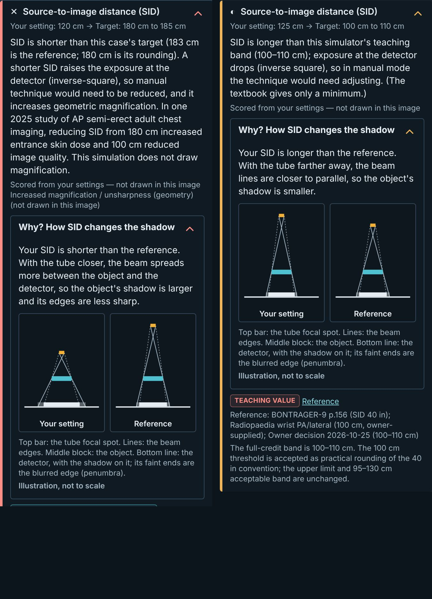
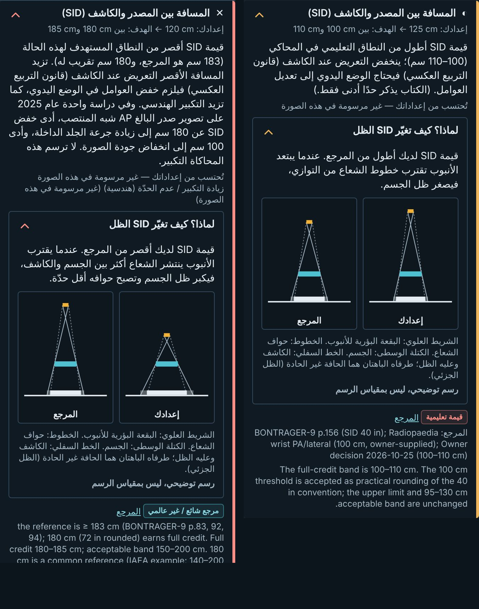

# RAD-098 — محرك صورة الأشعة، الجلسة 4: مفسّر هندسة SID، 2026-11-04

## 1. الانحرافات والميزانية

الميزانية المعلنة قبل التعديل: ≤10 ملفات تنفيذ و≤3 وحدات منتج. وحدات المنتج المستخدمة 3: `sid-geometry.ts` (جديدة، نقية)، `SidGeometryExplainer.tsx` (جديدة، رسم SVG فقط)، و`ResultPanel.tsx`.
ملفات التنفيذ 8: الوحدات الثلاث، `sid-geometry.test.ts`، `en.json`، `ar.json`، DECISIONS، ENGINE_GUIDE.
سجلات التسليم: project-status وHANDOFF وهذا التقرير وفهرس التقارير (docs:sync)، ولقطتان (586KB).
**استثناء S-STD-1 بموافقة المالك في هذه الجلسة:** إضافة المفسّر إلى بند SID تغيّر HTML لوحة النتيجة. لذلك تحدّثت مفاتيح `result|` في 10 ملفات هاشات (`scripts/qa/scene-dom/`)، منها ملفا القدم.
هذا يتجاوز الميزانية (8 + 10 ملفات تنفيذ). وافق المالك بشرط إثبات أن كل مفتاح متغير سيناريو SID فيه خارج نطاق الدرجة الكاملة (§4).
- `hashes.json` (الصدر) بلا متغير UPDATE_* قائم؛ وُلّد بنسخة مؤقتة غير ملتزمة من اختباره نفسه، أُضيف إليها سطر كتابة فقط ثم حُذفت. لا تعديل يدوي.
- بوابة المفسّر: قاعدة `range` على `sidCm` تعلن `variantOnLow: "magnified-geometry"` (الصدر الثلاثة والأطراف العشرة). Pelvis وGrashey لا تعلنها فلا مفسّر لهما (قاعدة: الحقول المحذوفة لا تضيف ملاحظات).

## 2. المنجز والمستبعد

- **منجز (Draft):** قرار المالك (الالتزام الأول)؛ الدالة النقية واختباراتها؛ المفسّر في بند SID، مغلق افتراضيًا؛ نصوص EN/AR جديدة فقط؛ تحديث الهاشات المثبت؛ ENGINE_GUIDE.
- **مستبعد بالقرار:** زاوية الأنبوب، التشوه خارج المحور، أرقام التكبير (الخيار B)، أي بكسل من صورة المريض، الدرجات، اعتمادات جديدة.
- لم تُلمس ملفات القدم غير ملفي الهاشات المذكورين (بإذن المالك).

## 3. لكل مهمة: RAD-098

#224–#226 مدمجة (Verified: origin/main عند البدء والنهاية؛ 3b لم تُدمج). تبقى RAD-098 `planned` وwaiting_on=owner: مراجعة هذه الـDraft، وقرار حواف القدم (3b)، وdenseZones. لا ready/merge.

## 4. التغييرات المشتركة وScale

**الهندسة:** مثلثات متشابهة فقط. التكبير = SID / (SID − فجوة الجسم). الظل الجزئي = عرض البقعة البؤرية × (التكبير − 1).
اللوحتان بمقياس رأسي واحد (الأطول يملأ اللوحة) وجسم وفجوة متطابقين، فلا يختلف بينهما إلا SID.
**المدخلات من البيانات فقط:** SID الطالب، والمرجع = أقرب حافة من `ideal` (أقرب إعداد كان سينال الدرجة الكاملة).
**أعراف الرسم (ليست بيانات فحص ولا تُعرض أرقامًا):** فجوة الجسم = 0.35 × SID المرجع، بسقف 0.6 × أقصر SID؛ وعرض الجسم والبقعة وأبعاد اللوحة. موثّقة في الكود وENGINE_GUIDE.
**إثبات الهاشات (Verified):**
- مع استبدال المفسّر بـnull فقط، نجحت الحراس الـ12 مقابل هاشات origin/main دون تعديل: الفرق الوحيد هو المفسّر.
- تشغيل مُجهَّز سجّل SID ونطاق `ideal` لكل لوحة من الـ676، وطابقها بترتيب المفاتيح.
- النتيجة: 596 مفتاحًا متغيرًا، كلها SID خارج النطاق؛ كل مفتاح متغير ⇔ المفسّر مرسوم؛ 0 مخالفات؛ مجموعة diff مطابقة لمجموعة الإثبات.
- مفاتيح `scene|` المتغيرة 0، وسطور diff غير `result|` 0.

| ملف الهاشات | المتغير (SID) | غير المتغير (SID) |
|---|---|---|
| hashes.json (صدر PA/Lateral/AP، `ideal` 180–185) | 40/48/48 (120، 200) | 0 |
| wrist، hand، elbow (لكل فحص، `ideal` 100–110) | 30، 30، 34 (90 أو 125، 200) | 2 لكل فحص (102) |
| knee-ap، knee-lateral، foot-ap، foot-oblique | 48 لكل ملف (90، 200) | 2 لكل ملف (102) |
| ankle-ap، ankle-lateral | 40 لكل ملف (90، 200) | 2 لكل ملف (102) |
| pelvis، shoulder | 0 | 24، 32 (لا تعلن magnified-geometry) |

**حارس ملتزم** (`sid-geometry.test.ts`): لكل حالة بقاعدة SID وأربع قيم (تحت/حافتا/فوق النطاق) × EN/AR، يظهر المفسّر مرة واحدة فقط عند خروج SID عن النطاق. وحذف شجرته من HTML يساوي حرفيًا الرسم مع المفسّر null.
Scale: لا سقف جديد. صفحة Practice الأكبر 479.5 من 500 KiB (wrist-pa EN).

## 5. الطب والدرجات

- Verified: الدرجات والأحكام والفحوص ونصوص feedback القائمة لم تتغير (التحقق بالحارس أعلاه و2571 اختبارًا). تغيّر السطر الأخير من كتلة result بفاصلة فقط.
- Verified: شهود البكسل وصور golden وcharacterisation بلا diff؛ صورة المريض لا تتغير (D-R3).
- النص الفيزيائي عام: SID أقصر ⇒ ظل أكبر وحواف أقل حدّة؛ SID أطول ⇒ ظل أصغر. لا أرقام تكبير أو OID (الاختبار يرفض أي رقم في المفسّر).
- مصطلحات عربية جديدة (البقعة البؤرية، الظل الجزئي) مسودة آلية؛ لم تُضف إلى ARABIC_TERMINOLOGY ضمن الميزانية (§7).

## 6. QA

| التصنيف | البند |
|---|---|
| Verified | `CI=true CI_TEST_LANE=unit npm run check`: typecheck، lint (0 أخطاء، تحذيرا vb/inv السابقان)، 2571/2571 في 153 ملفًا، منها 7 اختبارات جديدة. |
| Verified | health:source (0 أخطاء، layers فارغة)، health:test 9/9، health:sizes (0 أخطاء) بعد build:pages. |
| Verified | `npm run build` مرة واحدة، ثم `next start` للتدقيق. |
| Verified | EN/AR × 390/1440 + axe WCAG2 A/AA مع فتح المفسّر: Chest PA عند 120 و200، وWrist PA عند 90 و125. 16/16: المفسّر موجود، مغلق افتراضيًا، axe 0، لا تمرير أفقي، SVG ‏LTR في AR، لا pageerror/console. |
| Verified | الضبط داخل النطاق (Chest 180، Wrist 105) × 4: لا مفسّر. |
| Verified | marker الـpilot مطابق بين main والفرع: `pilot-v1:e2351641d105315383cb684f6c6ef1e918e1cd0bd2fc5dc2f1740d0ae301a7f1` (عنوان Supabase عام اصطناعي). |
| Verified | docs:sync مرتان بثبات، docs:check، `status:check --base origin/main --require-previous`، git diff --check. |
| Inferred | ترتيب اللوحتين في RTL (إعدادك يمينًا) صحيح للقراءة؛ الرسم نفسه لا ينعكس. |
| Not run | `qa:exam-audit`: playwright غير مثبت في node_modules، ورُفض ربطه آليًا؛ غطّى التدقيق أعلاه axe والتمرير والأخطاء. |
| Not run | هاتف حقيقي، مراجعة طبية/لغوية، CI البعيد بعد push. |

لقطات الهاتف (390، ×2): يسار Chest PA عند 120 (أقصر)، يمين Wrist PA عند 125 (أطول).

## 7. المفتوح

- **تعارض محتمل مع 3b:** إن دُمجت 3b أولًا وغيّرت هاشات القدم، يُدمج main ويعاد UPDATE_LOWER_LIMB_HASHES لملفي القدم (بأمر المالك)؛ لا تعديل يدوي.
- `hashes.json` بلا متغير UPDATE_*؛ إضافته تغيير أداة خارج النطاق (S-STD-3: يرفع عند أي تحديث هاشات صدر قادم).
- قرب SID من الحافة (مثل 95 مقابل 100) يعطي فرقًا ضئيلًا في الرسم؛ هذا صادق هندسيًا، ولا تضخيم إضافي دون قرار.
- مصطلحات المفسّر العربية تحتاج إدخالًا في ARABIC_TERMINOLOGY ومراجعة.
- Pelvis/Grashey بلا مفسّر لأن بياناتهما لا تعلن magnified-geometry؛ إضافته لهما قرار مالك.

## 8. قائمة المالك وبرومبت الجلسة التالية

1. راجع اللقطتين وجدول §4، وافتح «لماذا؟» على هاتفك في Chest PA (SID 120) ومعصم (125).
2. قرر فتح المفسّر لـPelvis/Grashey وإدخال المصطلحات في ARABIC_TERMINOLOGY.
3. تبقى Draft؛ لا ready/merge.

**برومبت مسودة — متابعة:** اقرأ AGENTS وHANDOFF وRAD-098 وهذا التقرير. إن دُمجت 3b: ادمج main، وأعد UPDATE_LOWER_LIMB_HASHES لملفي القدم، وأثبت بالحارس الملتزم أن الفرق هو المفسّر فقط. نفّذ ما قرره المالك في §8 فقط.
