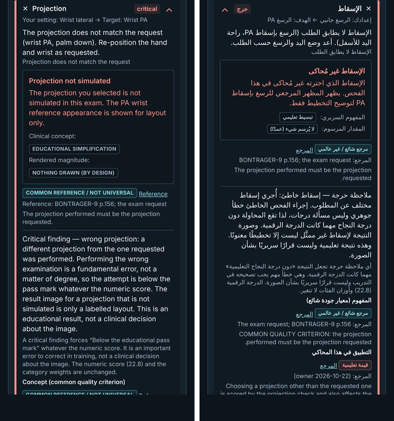
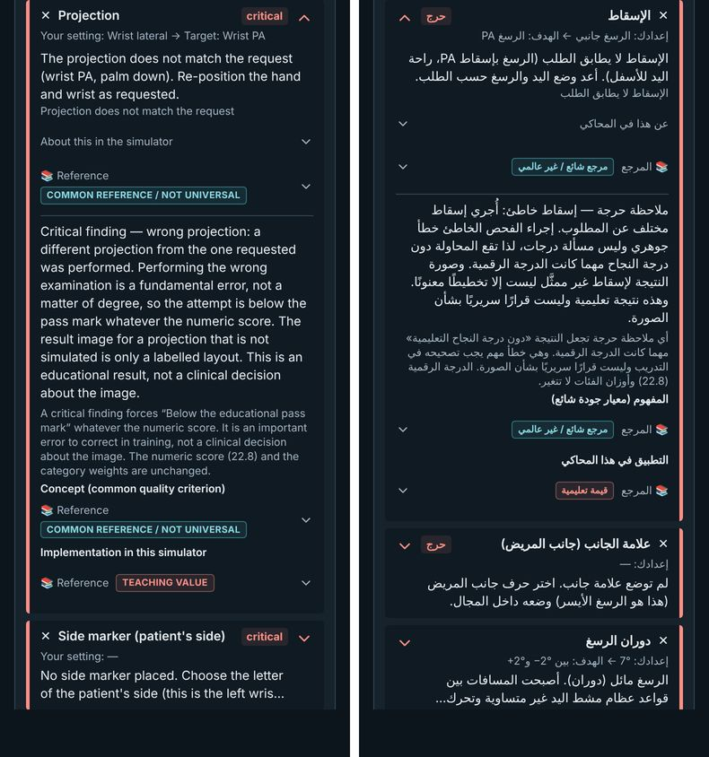

# RAD-100 — لوحة النتيجة: المراجع وشرح النموذج مطوية، 2026-11-04

## 1. الانحرافات والميزانية

الميزانية المعلنة قبل التعديل: ≤8 ملفات منتج/اختبار + ملفات هاشات scene-dom (استثناء معلن).
المستخدم 6: `ResultPanel.tsx`، `ResultDisclosure.tsx`، `RadiographEffects.tsx`، `messages/en.json`، `messages/ar.json`، و`result-text-guard.test.ts` (جديد).
ملفات الهاشات: 12 ملفًا قائمًا (مفاتيح `result|` فقط) وملف جديد `result-text-hashes.json` (بصمة نص الحارس).
سجلات التسليم: DECISIONS وproject-status وHANDOFF وهذا التقرير وفهرس التقارير (docs:sync) ولقطتان (285KB).
- **next_id:** RAD-099 ليست على main؛ قبل status:check الفجوة، فأخذت المهمة RAD-100 وصار next_id ‏RAD-101 كما طُلب.
- **بناءان لا بناء واحد:** بناء main إضافي فقط لالتقاط لقطتي «قبل»؛ وأُعيد بناء الفرع مرة بعد تصحيح لون (§4). آخر بناء هو المعتمد للقياسات.
- لا انحراف آخر؛ لم يُلمس `src/features/pilot/*`.

## 2. المنجز والمستبعد

- **منجز (Draft):** إغلاق RAD-098 وقرار المالك ومهمة RAD-100 (الالتزام الأول)؛ الحارس الملتزم على markup main (الالتزام الثاني)؛ الطي وتحديث الهاشات (الالتزام الثالث).
- كتلة المرجع لكل فحص: زر واحد مغلق «📚 Reference / 📚 المرجع» مع شارة الدليل ظاهرة وهو مغلق. عند الفتح: رابط المراجع وسطر المصدر في سطر واحد، والملاحظة الطويلة داخل «More details / تفاصيل أكثر» مغلقة.
- صندوق شرح النموذج لكل فحص (العنوان والنص وشارتا المفهوم/المقدار) داخل «About this in the simulator / عن هذا في المحاكي» مغلق.
- كتل الدليل تحت الملاحظات الحرجة تستعمل الدالة نفسها، فطُويت بالطريقة نفسها.
- **مستبعد:** نص طبي جديد أو ترجمة الملاحظات الإنجليزية؛ تغيير درجة أو حكم أو feedback؛ صورة المريض؛ قائمة التأثيرات في «عن هذه الصورة» (ليست لكل فحص) تبقى كما هي.

## 3. لكل مهمة

- **RAD-098:** `done`. #220 و#224–#230 مدمجة (Verified: قراءة GitHub). لم ينقل docs:sync الوصف السابق إلى الأرشيف لأن المهمة لم تكن done قبلًا؛ نصه باقٍ في git وتقارير الجلسات.
- **RAD-100:** `review`، waiting_on=owner: مراجعة الـDraft وفحص الهاتف. لا ready/merge.

## 4. التغييرات المشتركة وScale

- `ResultDisclosure`: خاصية اختيارية `compact` (زر بلا حدود أو حشو أفقي، ارتفاع ≥44px). المسار الافتراضي بايتات مطابقة لما سبق، فلا تتغير صفحات أخرى تستعمله (التدريب، Assess، المحاكي).
- `RadiographEffect`: خاصية اختيارية `flat` تحذف حدود البطاقة داخل الطي فقط، فلا تتراكم الحدود.
- التصحيح الوحيد بعد أول تدقيق: أُزيل `text-ink` عن القائمة المطوية ليبقى لون النص الموروث كما في main.
- **الحارس الملتزم** (`result-text-guard.test.ts`): لكل فحص من 17 × EN/AR، شبكة سيناريوهات تشمل قيم الدوران والعلامة والتوسيط والتحديد وSID وkVp وmAs والزاوية والإسقاط والخيارات المستعملة في حراس scene-dom. يجمع عقد النص بالترتيب من HTML الخادم.
- يحذف الحارس فقط العناصر الموسومة `data-ui-label` (التسميات الجديدة الثلاث والرمز). المحتوى المطوي مركّب دائمًا (hidden)، فالنص يساوي حالة فتح كل العناصر. البصمة التُقطت من markup main قبل أي تعديل.
- **شاهدا الرفض (Verified):** حذف الملاحظة الداخلية أفشل الحارس؛ ونزع الوسم عن تسمية جديدة أفشله. ثم أعيد الكود ونجح.
- **الهاشات (Verified):** وُلّدت بمتغيرات UPDATE_* القائمة، و`hashes.json` بنسخة كتابة مؤقتة من اختباره حُذفت بعد التشغيل. لا تعديل يدوي.
- تغيّر 676 مفتاح `result|` من 676، و0 مفتاح `scene|`، وترتيب المفاتيح مطابق في الملفات الـ12.
- لا diff في golden أو characterisation أو `radiograph-pixel-witnesses.json`.
- Scale: لا سقف جديد. أكبر صفحة Practice ‏480.2 من 500 KiB (ar ankle-ap).

## 5. الطب والدرجات

- Verified: نص اللوحة كله بالترتيب مطابق لـmain مع فتح كل العناصر (الحارس)؛ لا نص طبي جديد. السلاسل الجديدة ست تسميات تحكم (EN/AR) فقط.
- Verified: 2579 اختبارًا ناجحًا تشمل الدرجات والأحكام والملاحظات الحرجة؛ صورة المريض بلا تغيير (شهود البكسل).
- شارة الدليل (provisional/educational وغيرها) ظاهرة في الحالة المغلقة (Verified في المتصفح).

## 6. QA

| التصنيف | البند |
|---|---|
| Verified | `CI=true CI_TEST_LANE=unit npm run check`: typecheck، lint (0 أخطاء؛ تحذيرا `simulator-layout-audit.mjs` السابقان)، 2579/2579 في 154 ملفًا. |
| Verified | التشغيل الكامل بلا lane: فشل 37 ملفًا عند إعداد PostgreSQL (Docker أو حزمة `pg` غير متاحين في الحاوية) قبل أي تأكيد؛ لا يستورد أي منها الملفات المعدلة إلا `en.json`. CI يشغلها. |
| Verified | health:source (0 أخطاء)، health:sizes (0 أخطاء بعد build:pages)، health:test 9/9. |
| Verified | `npm run build:pages` ناجح على الكود النهائي. |
| Verified | `qa:exam-audit` ‏Chest PA وWrist PA وFoot oblique × EN/AR × 390/1440 (الحالة المغلقة بعد Expose): 198/198، axe 0، لا تمرير أفقي، لا أخطاء. |
| Verified | تدقيق مؤقت غير ملتزم للفحوص الثلاثة × EN/AR × 390/1440: زر المرجع موجود ومغلق والشارة ظاهرة، وaxe ولا تمرير في الحالتين المغلقة والمفتوحة، وأهداف اللمس ≥44px، ولا أخطاء: 120/120. |
| Verified | marker الـpilot مطابق بين main والفرع: `pilot-v1:d1525a9b635bf78200f100f7632e4cdca41a3b47ecf1e48cc10608e4a9207d11` (عنوان Supabase اصطناعي). |
| Verified | docs:sync مرتان بثبات، docs:check، `status:check --base origin/main --require-previous`، git diff --check. |
| Inferred | ترتيب الرابط قبل سطر المصدر يحافظ على ترتيب main؛ تكرار كلمة «المرجع» في السطر المفتوح مقبول لأن النص قائم ولا نص جديد. |
| Not run | هاتف حقيقي (يفحصه المالك)، مراجعة لغوية/طبية، CI البعيد. |

لقطتا الهاتف (390، Wrist PA بعد Expose، أول بند مفتوح؛ يسار EN ويمين AR):

## 7. المفتوح

- سطر الرابط والمصدر يكرر كلمة «Reference/المرجع» (الرابط نص قائم إلى صفحة المراجع). تغييره نص جديد يحتاج قرار المالك.
- بصمة النص الجديدة golden إضافي: أي تغيير نص لاحق في اللوحة يحتاج `UPDATE_RESULT_TEXT=1` بقرار مالك (S-STD-3: الرفع عند أول تغيير نص مقصود).
- `hashes.json` ما زال بلا متغير UPDATE_*؛ إضافته خارج النطاق.

## 8. قائمة المالك وبرومبت الجلسة التالية

1. افتح نتيجة Chest PA وWrist PA وFoot oblique على هاتفك بالعربية والإنجليزية: «📚 المرجع» مغلق والشارة ظاهرة؛ «تفاصيل أكثر» و«عن هذا في المحاكي» مغلقان.
2. قرر إن كان تكرار «المرجع» في السطر المفتوح مقبولًا.
3. تبقى Draft؛ لا ready/merge دون أمرك.

**برومبت مسودة:** اقرأ AGENTS وHANDOFF وRAD-100 وهذا التقرير. سجّل إغلاق RAD-100 أو ملاحظات المالك أولًا، ونفّذ فقط ما قرره في §8.
