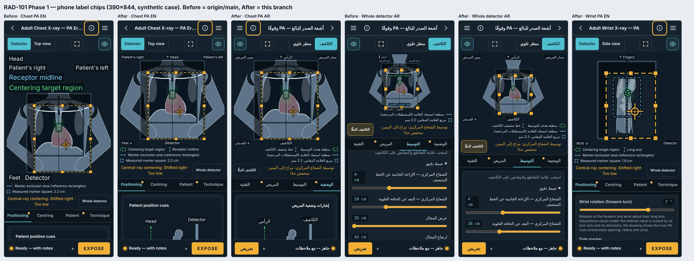

# RAD-101 المرحلة 1 — تسميات الهاتف رقائق صغيرة وسطر إيضاح، 2026-11-04

المرجع: قرار D2 (المرسى `rad101-phone-ui-owner-2026-11-04`، يعدّل [A1](../../../DECISIONS.md#rad077-owner-2026-10-24))، و§3ب و§3د من تقرير التدقيق `RAD-101_PHONE_UI_AUDIT_2026-11-04.md`. القرار والتقرير في Draft ‏#234 (لا روابط هنا حتى يُدمج)؛ الترتيب S-STD-1. **يُدمج بعد إطلاق الخميس فقط.**

## 1. الانحرافات والميزانية

- **الميزانية المعلنة:** `PhoneFrameLabels.tsx` و`DetectorWorkspace.tsx` و`MarkerGuides.tsx` واختبار جديد `phone-frame-chips.test.ts`؛ هذا التقرير ولوحة قبل/بعد واحدة (298 KiB) وفهرس التقارير. المستخدم مطابق: 3 ملفات منتج + اختبار + 3 وثائق.
- **project-status وHANDOFF دون تعديل هنا:** RAD-101 وقراراتها غير موجودة على main حتى يُدمج #234؛ تعديلها من main يصنع تعارضًا. حالة #234 تقول أصلًا «المرحلة 1 Draft مستقل يُدمج بعد الإطلاق».
- **انحراف صغير في الشكل:** سهم «↑» قبل الرأس/محور الأعلى و«↓» بعد القدمين/محور الأسفل داخل الرقاقة، بدل السهم المرسوم الذي لا يُرسم خارج الكاشف. رمز لا كلمة؛ لا مفتاح ترجمة جديد.
- **انحراف في التطبيق:** القرار ذكر «على حافة الرسم»؛ وضعت الرقائق في صف ملاصق فوق الرسم وصف تحته (لا فوقه)، لأن المقابض الثمانية ومنطقة اللمس ≥44px تقع على حافة المجال في العرض الملائم، وأي رقاقة فوق الرسم تغطيها بصريًا. إن أردتها داخل الإطار فهي مرحلة لاحقة.
- لا ملف مثبّت ببصمة، ولا `fit-view`/`touch-geometry`/`coords`، ولا رسائل، ولا تقييم.

## 2. المنجز والمستبعد

- **منجز (هاتف فقط، العرض الملائم و«الكاشف كاملًا» والمشهد المكبَّر):** صف علوي واحد: الرأس (أو محور الفحص) في الوسط، وجهتا الصورة في خانتيهما الفعليتين (لا تنعكسان بالعربية)؛ صف سفلي واحد: القدمان/المحور والكاشف. أصغر خط 12px والباقي بنسبته؛ الرقاقة نفسها (`SceneLabel`) بحشوتها ولونها.
- «منطقة هدف التوسيط» و«خط منتصف الكاشف» (أو محور الطرف) لم تعودا تسميتين فوق الرسم؛ صارتا أول سطر في وسيلة الإيضاح تحت الرسم، بشكلين مختلفين (مستطيل أخضر متقطع، خط عمودي متقطع)، وتظهران مع الإرشادات فقط كما قبل.
- في «الكاشف كاملًا» لا تُرسم تسميات الإطار داخل SVG على الهاتف، فزال تغطية المقابض لـ«القدمان/الكاشف» وعبور المقبض لتسمية المنتصف.
- **مستبعد:** المراحل 2–5 (هيكل الخطوات، الطبقات لكل قسم، صفوف ±، «لوح الكتف»).

| 390×844 (Verified، قياس DOM) | قبل | بعد |
|---|---|---|
| تسميات الإطار، الصدر PA | 172px (4 صفوف + صف) | 41px (صف + صف) |
| الظاهر من لوحة التبويب، الصدر PA | 62px | 173px |
| تسميات الإطار، الرسغ PA | 93px | 43px |
| الظاهر من لوحة التبويب، الرسغ PA | 141px | 172px |

## 3. لكل مهمة

- **RAD-101:** المرحلة 1 في هذا الـDraft؛ الحالة `in_progress` مسجلة في #234. لا ready/merge قبل الإطلاق وأمر المالك.

## 4. التغييرات المشتركة وScale

- `PhoneFrameLabels`: خاصية اختيارية `minPx` ودالة نقية مصدّرة `chipScale`؛ دونها السلوك القديم. `frameRows`/`orientationRows` دون تغيير توقيع، و`phone-frame-rows.test.ts` دون تعديل.
- `MarkerGuideLegend`: خاصية اختيارية `centring`؛ دونها المخرج مطابق (الحاسوب وحراس scene-dom).
- `DetectorWorkspace`: كل التغيير خلف `phone`؛ المسار المكتبي (context=null) لم يتغير.
- **Scale:** يعمل لكل الفحوص الـ17 من المكوّن المشترك ومن خانات `Orientation` الموجودة. **السقف:** صف واحد يفترض أن تسميات الخانة الواحدة تتسع لثلث العرض بخط 12px؛ لغة أو نص أطول يلف إلى صف ثانٍ (لا قص). المحفّز: تسمية أعرض من ثلث 390px.

## 5. الطبي والتقييم

لا تغيير في التقييم أو القيم أو التغذية الراجعة أو الجاهزية أو صورة المريض أو الصورة الشعاعية أو الإحداثيات المحفوظة. النصوص هي المفاتيح القائمة نفسها. تلميحات Practice كلها باقية (الهدف والمنتصف في الإيضاح، سطر التوسيط، اصطلاح العلامة).

## 6. QA

- **Verified:** typecheck وlint؛ اختبارات الوحدة (CI_TEST_LANE=unit): 156 ملفًا و2592 اختبارًا ناجحة، منها الاختبار الجديد. حراس scene-dom الثمانية و`phone-frame-rows` تمر **دون تعديل أي بصمة أو توقع**.
- **Not run محليًا:** مسار DB (يحتاج PostgreSQL؛ يعمل في CI)؛ تشغيل `npm run check` الكامل محليًا فشل في 37 ملف DB فقط لغياب القاعدة، لا لهذا التغيير.
- **Verified:** `npm run build`؛ `simulator-layout-audit` (6 فحوص، EN/AR، 390/1440): 1520 فحصًا و84 axe؛ 12 فشلًا كلها «same scene drawings as desktop» على الهاتف (5 مقابل 3). **قائم على main:** على بناء main الفحص نفسه يفشل (7 مقابل 3 للصدر، 6 مقابل 2 للرسغ) لأن أشرطة التسميات SVG إضافية منذ RAD-077؛ هذا التغيير خفّضها ولم يُعدَّل السكربت. لا فشل axe.
- **Verified:** `label-collisions --obstacles` للفحوص الـ17 بمواصفاتها: على 390 (EN وAR، الإرشادات تعمل/لا) **0 تداخل أو خروج في 3384 حالة**، وأصغر تسمية 12px في كل الفحوص. على 1440 (كود الحاسوب غير المتغير) 360 حالة بملاحظة في الصدر الثلاثة فقط (Feet/Detector/الهدف × مقبض أو حد المجال)؛ هذه نتائج الصدر المسجلة نفسها التي جعلت `--obstacles` معطلًا افتراضيًا للصدر، ولم تُعدَّل عتبة.
- **Verified:** `exam-audit --all`: 1122 فحصًا على 17 فحصًا × EN/AR × 390/1440، 0 فشل (axe ولا تمرير أفقي وورقة الحالة والتبويبات والتعريض والنتيجة).
- **Verified:** `health:sizes`: بناء static: صفحات practice ‏494,348 بايت gzip = 482.8 KiB (قبل 482.4؛ +337 بايت) من سقف 500؛ 0 أخطاء، والصورة الجديدة دون 500 KiB.
- **Not run:** فحص الهاتف الحقيقي (للمالك).

## 7. بنود مفتوحة

1. تعديل `simulator-layout-audit` ليستثني أشرطة التسميات من مقارنة «same scene drawings» (قائم على main؛ يحتاج قرارًا لأنه يغيّر أداة QA).
2. المراحل 2–5 بموافقات منفصلة.

## 8. قائمة المالك

- [ ] بعد الإطلاق: افتح الـDraft على الهاتف (Samsung، EN وAR): صف علوي واحد (الرأس والجهتان)، صف سفلي (القدمان والكاشف)، والهدف والمنتصف في الإيضاح تحت الرسم.
- [ ] «الكاشف كاملًا» و«تكبير المشهد»: لا تسمية تحت المقابض.
- [ ] فحص طرف واحد (الرسغ أو الركبة) وفحص الحوض أو الكتف.
- [ ] قرار: الرقائق ملاصقة للرسم (كما هنا) أم داخل إطاره؟
