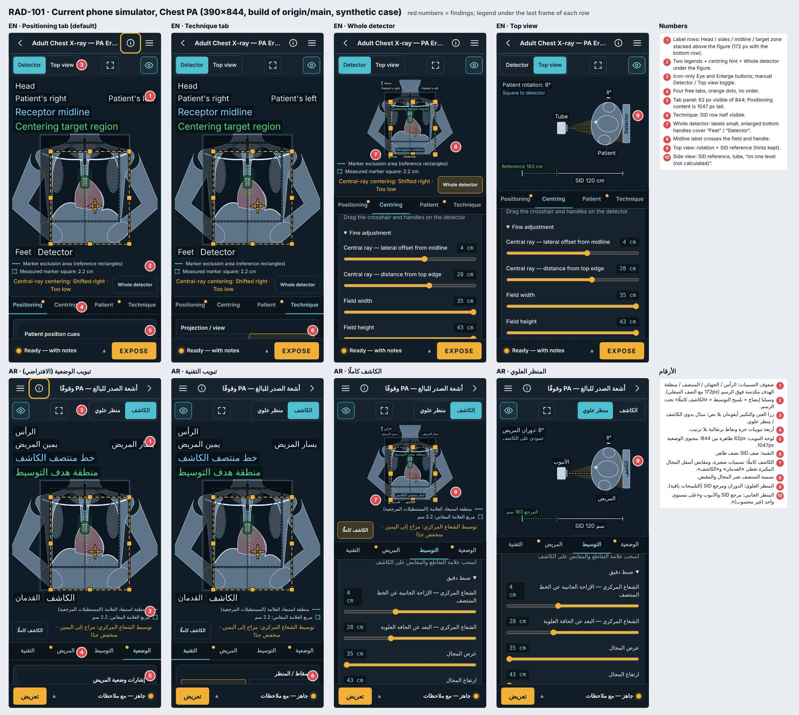
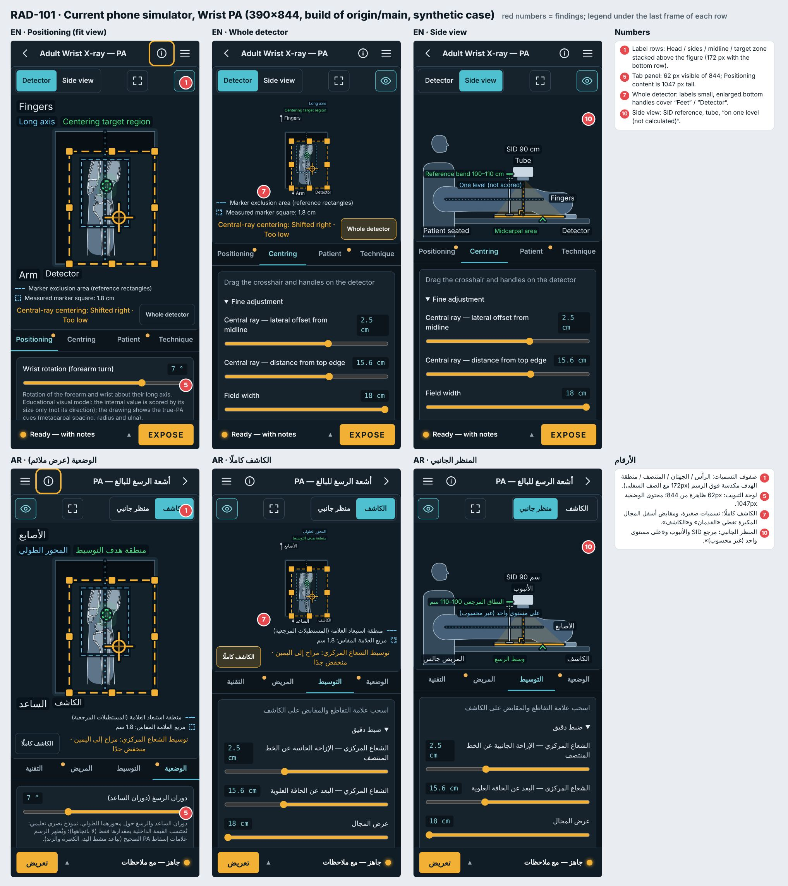
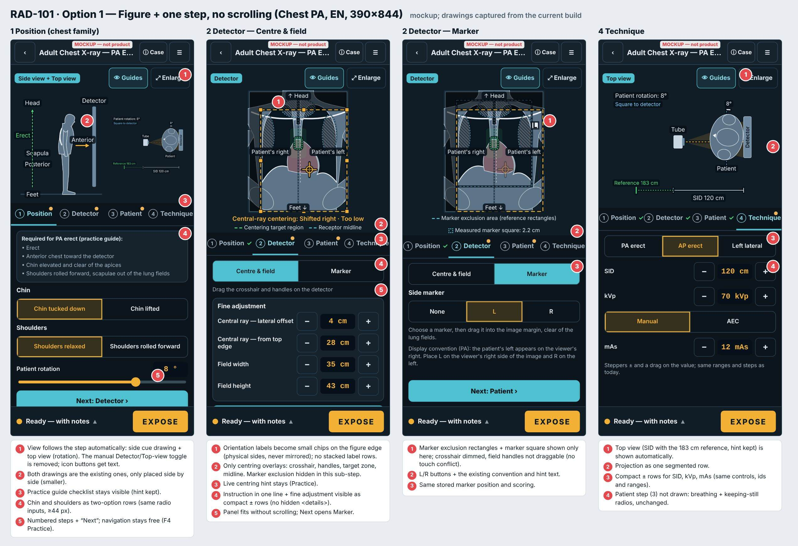
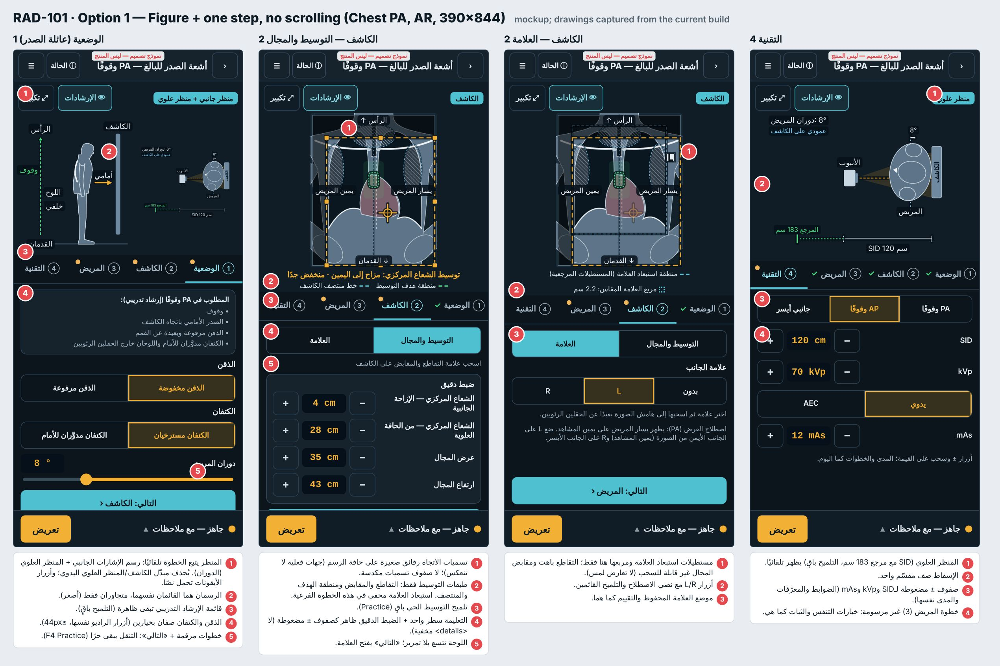
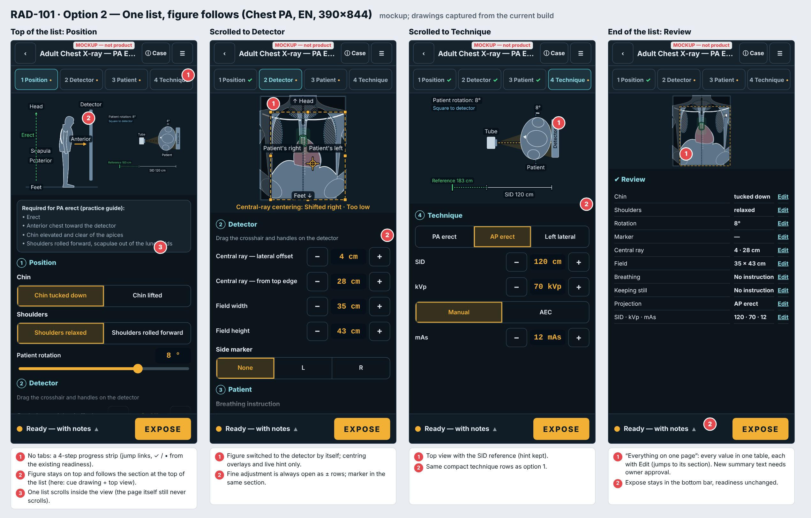
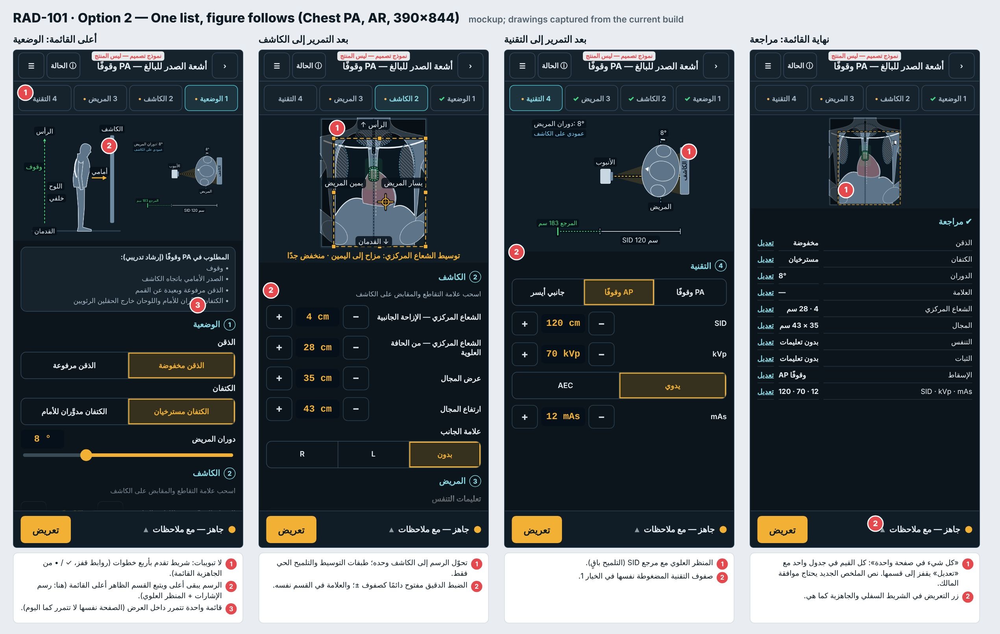

# RAD-101 — تبسيط واجهة المحاكي على الهاتف: تدقيق ونماذج (وثائق فقط)، 2026-11-04

المرجع: [F3/F4](../../../DECISIONS.md#ui-inventory-owner-2026-10-22) و[تقرير UI-3](../../../RAD-067_UI3_REPORT_2026-10-22.md) §9–11 (تطبيق بملء الشاشة، تكبير المشهد، الملاءمة) و[قرار A1](../../../DECISIONS.md#rad077-owner-2026-10-24) (صفوف التسميات). مدخل المالك 2026-11-04: الطلاب يرونه معقدًا؛ «كل شيء في الصفحة نفسها»؛ تلميحات Practice باقية. الترتيب S-STD-1.

## 1. الانحرافات والميزانية

- **الهدف:** جرد وتشخيص ونموذجان وخطة؛ لا كود منتج. **الميزانية:** ≤10 ملفات وثائق وصور؛ المستخدم 10، ثم DECISIONS بطلب المالك (11): هذا التقرير، project-status، HANDOFF، فهرس التقارير (docs:sync)، و6 صور JPEG في `docs/review/rad-101/` (2.7 MB دون حد 5 MB للـPR، وكل صورة دون 500 KiB؛ صورتان أُعيد ضغطهما بعد أن رفضهما `health:sizes`).
- لا ملف تحت `src/` ولا اختبار ولا بصمة. سكربتات الالتقاط والنماذج مؤقتة في مساحة الجلسة ولم تُلتزم (سياسة اللقطات).
- **انحراف:** «الخلل» 2 ليس خطأ برمجيًا بل نتيجة قرار A1 المقبول («دون تصغير الخط»)؛ إصلاحه يحتاج تعديل ذلك القرار (§3، سؤال 2).
- `next_id`: لم تأخذ أي فرع بعيد RAD-101 (فحص `project-status.md` في كل الفروع المحلية البعيدة)؛ أخذتها هذه المهمة، وصار next_id ‏RAD-102.

## 2. المنجز والمستبعد

- **منجز:** جرد الشاشة (Chest PA وWrist PA، EN/AR، 390×844) بلقطات اصطناعية؛ سبب التسميات بالملف والسطر؛ نموذجان مع لوحات EN/AR؛ عدّ اللمسات؛ خطة مراحل.
- **مستبعد:** أي تغيير كود أو نص أو تقييم؛ الوضع الأفقي؛ صفحة النتيجة (RAD-100)؛ Assess.

## 3. لكل مهمة — RAD-101 (`planned`، waiting_on=owner)

### أ) الجرد (لقطات البناء المحلي لـorigin/main)

| المنطقة | العناصر (Chest PA؛ الفرق في الرسغ) | قياس 390×844 |
|---|---|---|
| الشريط العلوي | رجوع، العنوان (مقطوع بالإنجليزية)، (i) تفاصيل الحالة (تُفتح تلقائيًا مرة)، القائمة | 53px |
| ترويسة المشهد | مبدّل يدوي «الكاشف / منظر علوي» (الرسغ: «منظر جانبي»)، زر تكبير بأيقونة فقط، زر العين (الإرشادات) بأيقونة فقط | 44px |
| صفوف التسميات (العرض الملائم الافتراضي) | الرأس؛ يمين/يسار المريض؛ خط المنتصف؛ منطقة الهدف؛ وتحت الرسم: القدمان + الكاشف (الرسغ: الأصابع؛ المحور الطويل + الهدف؛ الذراع + الكاشف) | 172px (الرسغ 93px) |
| رسم الكاشف | التشريح؛ تظليل أخطاء الوضعية (الذقن/لوحا الكتف) مع الإرشادات؛ خط المنتصف؛ منطقة الهدف (مستطيلان)؛ مستطيلات استبعاد العلامة ومربعها؛ ظل المجال وحدّه؛ 8 مقابض؛ شارة العلامة؛ التقاطع — حتى 8 طبقات معًا | 287px |
| تحت الرسم | وسيلتا إيضاح العلامة، سطر حالة التوسيط (تلميح)، زر «الكاشف كاملًا» | ~95px |
| التبويبات | 4 حرة (الوضعية · التوسيط · المريض · التقنية) ونقطة برتقالية على غير الجاهز | 44px |
| لوحة التبويب | الظاهر منها **62px** (الرسغ 141px). محتوى: الوضعية 1047px (رسم الإشارات 8 تسميات، قائمة المطلوب، الذقن 2، الكتفان 2، الدوران، العلامة 3 وتلميحان)؛ التوسيط 114px و382px مع «ضبط دقيق» مفتوحًا (4 منزلقات)؛ المريض 631px (تنفس 4، ثبات 3)؛ التقنية 496px (الإسقاط 3، SID، kVp، الوضع، mAs) | — |
| الشريط السفلي | الجاهزية (تفتح ورقة) + تعريض | 62px |
| حوارات | ورقة الحالة، ورقة الجاهزية، المشهد المكبَّر | — |

النتيجة: على الصدر 7% فقط من الشاشة للضوابط، فيتمرر الطالب داخل نافذة 62px. «الكاشف كاملًا» يعيد 318px للوحة، لكنه ليس الافتراضي.
البند 5 (المالك): في رسم الإشارات الجانبي تسمية `scapula` بالعربية «اللوح» (`messages/ar.json:113`) تُقرأ «لوح خشب»، وتحتها مباشرة «خلفي» (`PatientCues.tsx:76,80`) فتبدوان كلمتين منفصلتين؛ والخط الأخضر يعبر «Scapula/Posterior» بالإنجليزية. [المصطلحات](../../../ARABIC_TERMINOLOGY.md) تقترح «لوحا الكتف».
البند 6: «ضبط دقيق» `
` مغلقة على الهاتف (`PositioningView.tsx:122`)، والتعليمة سطر واحد `touchHint`.

### ب) سبب التسميات المكدسة والتداخل (Verified بالقياس والكود)

1. على الهاتف العرض الملائم هو الافتراضي (`PositioningView.tsx:208` ‏`fit={phone && !showWhole}`)، فـ`frameRows = phone && fit` (`DetectorWorkspace.tsx:230`) يرسم التسميات خارج الرسم في 4 أشرطة SVG مستقلة: ثلاثة فوقه (`:233–244`) وواحد تحته (`:362–365`).
2. كل شريط `viewBox="0 0 <عرضه بالبكسل> …"` (`PhoneFrameLabels.tsx:79`): الوحدة = 1px. أحجام `SceneLabel` (`SceneParts.tsx:74`) بوحدات المشهد (`LABEL_SIZE.detector` = 20، و24 للإرشادات، `scene-style.ts:105`) فتُرسم 20–24px، أي أكبر من نص الصفحة، بينما الرسم نفسه مصغّر.
3. الرصّ (`PhoneFrameLabels.tsx:14–28` و`35–54`) صف لكل شريط على الأقل، وتسميتا الإرشادات بحجم 24 لا تتسعان في صف واحد → 4 صفوف فوق الرسم.
4. هذا تنفيذ حرفي لـA1 («بقياس النص … دون تصغير»)، وقد سجّل تقرير RAD-077 نفسه سقف «صفوف كثيرة على هاتف أقصر تحتاج تدقيق المساحة».
5. **التداخل:** في «الكاشف كاملًا» تُرسم القدمان/الكاشف (`DetectorWorkspace.tsx:328–334`, `:360`) قبل المقابض (`:336–341`) ودون `bounds` على الهاتف (`:332`, `:360`)، والمقابض مكبَّرة للمس (`touchGeometry`، `:132`)، فيغطي مقبضا الحافة السفلية «Feet/القدمان» و«Detector/الكاشف» ويعبر المنتصفَ مقبضٌ (اللقطة، رقم 7–8). حالة «القدمان فوق الكاشف» بلفظها لم أُعِد إنتاجها بالإعدادات الافتراضية (Inferred: أي حالة تقرّب التسميتين).

**الإصلاح المقترح (المرحلة 1، هاتف فقط):** (أ) تسميات الاتجاه رقائق صغيرة على حواف الرسم بحجم مقياس المشهد مع حد أدنى 12px، بالجهات الفعلية دون انعكاس (يبقى `orientationSlot`)؛ (ب) تسميتا المنتصف والهدف تنتقلان إلى سطر وسيلة الإيضاح بالنصين القائمين ولون العلامة؛ (ج) تسمية «الكاشف» تسقط من الهاتف (موجودة في `figcaption` للقارئات وفي وسم المنظر)؛ (د) العرضان (الملائم والكامل) بالمنطق نفسه فيزول التداخل. المتوقع: 172px → نحو 30px (Inferred). يحتاج تعديل A1 بقرار.

### ج) النموذجان (390×844، رسوم مأخوذة من البناء الحالي، النصوص الجديدة مسودة)

**الخيار 1 — الرسم ثم خطوة واحدة، بلا تمرير (موصى به):**

**الخيار 2 — قائمة واحدة والرسم يتبعها («كل شيء في صفحة واحدة»):**

| | الحالي | الخيار 1 | الخيار 2 |
|---|---|---|---|
| ما ينتقل | — | العلامة إلى خطوة «الكاشف» (فرعيتان: التوسيط والمجال / العلامة)؛ الضبط الدقيق صفوف ± ظاهرة؛ التبويبات مرقمة + «التالي» | لا تبويبات؛ شريط تقدم 4 خطوات؛ الأقسام متتالية في لوحة تتمرر داخليًا؛ جدول «مراجعة» في آخرها |
| ما يُحذف/يُخفى | — | مبدّل المنظر اليدوي (المنظر يتبع الخطوة)؛ صفوف التسميات؛ استبعاد العلامة خارج خطوة العلامة؛ المقابض غير قابلة للسحب في خطوة العلامة | مثل 1، والمنظر يتبع القسم الظاهر |
| ارتفاع اللوحة | 62px | ~390px (Inferred) | ~430px تتمرر |
| لمسات/سحبات Chest PA الصحيح* | 16 + ≥32 نافذة تمرير | 18 + 0 تمرير | 15 + ~3 نوافذ |
| مخاطر | — | +2 لمسة «التالي»؛ صدر: رسمان متجاوران أصغر | الرسم يتغير أثناء التمرير (حركة، `prefers-reduced-motion`)؛ يخالف روح «لا صفحة طويلة» (فحص الهاتف 1) |

\* الهدف من سيناريو `correct` في `scripts/qa/scenarios.json` (لا قيم جديدة). الحالي: بدء 1؛ الذقن والكتفان والدوران والعلامة 4؛ سحب التقاطع وزاوية المجال 2 (من أي تبويب)؛ تبويب المريض 1 + خياران؛ تبويب التقنية 1 + إسقاط وSID وkVp وmAs 4؛ تعريض 1. التمرير من ارتفاع المحتوى ÷ 62px (Inferred). الخيار 1 يضيف 4 «التالي/تبويب» و1 للخطوة الفرعية بدل تبويبين.

**الإتاحة (الخياران):** كل هدف ≥44px (صفوف ± في النموذج 40px ارتفاعًا تُرفع إلى 44)؛ الخيارات تبقى `input[type=radio]` داخل `fieldset` (لا أزرار `aria-pressed` بديلة)؛ أزرار الأيقونات بنص مرئي فيسقط خطر الاسم المخفي؛ تغيير المنظر تلقائيًا لا ينقل التركيز ويُعلن بـ`figcaption` لا `aria-live` (تجنب الضجيج)؛ RTL: ترتيب الخطوات والأسهم معكوس، وجهات الصورة لا تنعكس؛ ألوان الإيضاح مع نص (لا لون وحده)؛ تباين الرقائق ≥7:1 كما في ENGINE_GUIDE. axe: الخيار 1 يبقي tablist/tab/tabpanel؛ الخيار 2 يحتاج `nav` لشريط التقدم وعناوين أقسام.
**حجم الصفحة:** practice الحالي 482.4 KiB من سقف 500 KiB (هامش 17.6 KiB فقط، §6)؛ المتوقع للخيار 1 تغيّر صغير (حذف منطق الأشرطة، إضافة ربط المنظر)، وللخيار 2 زيادة طفيفة (مراقبة التمرير + جدول المراجعة). كلاهما Inferred ويُقاس بـ`health:sizes` في كل PR مقابل سقف 500 KiB.
**على الفحوص الـ17:** `PhoneWorkspace` و`PositioningView` و`DetectorWorkspace` مشتركة، فالتخطيط واحد للجميع. ربط المنظر بالخطوة بيانات اختيارية في `SceneLayout`:

| العائلة (العدد) | الوضعية | الكاشف | التقنية |
|---|---|---|---|
| الصدر PA وLateral (2) | رسم الإشارات + المنظر العلوي (الدوران) | الكاشف | المنظر العلوي (SID ومرجع 183) |
| الصدر AP مستلقيًا (1) | رسم الإشارات + المنظر الجانبي | الكاشف | المنظر الجانبي (SID وزاوية الأنبوب) |
| الأطراف (12) | الكاشف دون طبقات التوسيط (الدوران يُرسم على التشريح) | الكاشف | المنظر الجانبي (SID) |
| الحوض والكتف (2) | يُتحقق في المرحلة 3 أين يظهر الدوران (Not run) | الكاشف | المنظر الثاني |

خطوة المريض: نفس منظر الوضعية. وضع Assess لاحقًا: الإرشادات مطفأة كما اليوم، والتنقل الإجباري (F4) أسهل مع الخطوات المرقمة.

### د) خطة المراحل بعد قرار المالك (Draft لكل مرحلة، بموافقة منفصلة)

قرار المالك 2026-11-04 ([D1–D6](../../../DECISIONS.md#rad101-phone-ui-owner-2026-11-04)): الخيار 1 دون جدول أو ورقة «مراجعة». النماذج أعلاه سبقت القرار؛ ترتيب الخطوات وأسماء الأزرار في D3/D4 هي الحاكمة. أُلغيت مرحلة الخيار 2.

| المرحلة | الميزانية | الاختبارات | البصمات والحراس |
|---|---|---|---|
| 1 إصلاح التسميات (D2) — PR مستقل يُدمج بعد إطلاق الخميس | `PhoneFrameLabels.tsx`، `DetectorWorkspace.tsx`، `MarkerGuides.tsx` + اختبار جديد | وحدة للرقائق؛ `phone-frame-rows.test.ts` دون تعديل؛ `simulator-layout-audit` و`label-collisions` 17×EN/AR×390 | scene-dom دون تغيير (المسار المكتبي context=null) |
| 2 هيكل الخطوات (D1، D3، D4) | `PhoneWorkspace.tsx`، `PositioningView.tsx`، `workspace-tabs.ts` (+اختبار)، `ConsolePanel.tsx` (الإسقاط إلى الخطوة 1)، `messages/{en,ar}.json` | الترتيب: الوضعية ← الكاشف ← التقنية ← تعليمات المريض؛ حالة الشريحة (منجز/ملاحظة/لم يبدأ) من الجاهزية وزيارة الخطوة، بلا تقييم؛ الشريط السفلي «التالي» و«تعريض» والتعريض متاح في كل خطوة؛ المنظر يتبع الخطوة؛ «Aids/Zoom/Full detector» بنص؛ أهداف 44px؛ لا تمرير للمستند؛ `health:sizes` ≤500 KiB | لا بصمة؛ النصوص الجديدة تُعرض على المالك قبل الدمج |
| 3 قسما «الكاشف» وطبقاته (D3، D4) | `DetectorWorkspace.tsx` (خاصية اختيارية للطبقات وأهداف السحب)، `PositioningView.tsx`، `workspace-tabs.ts` | قسما «التوسيط والمجال» و«العلامة»؛ مناطق استبعاد العلامة في قسم العلامة فقط؛ `marker-missing` يشير إلى الخطوة 2؛ السحب يعطي القيمة نفسها | المسار المكتبي مطابق بايتًا |
| 4 صفوف ± ظاهرة (D6) | `PositioningView.tsx`، `StepField.tsx`، `PatientCues.tsx` (خاصية `phone`) | إزاحتا التوسيط وحجم المجال والدوران صفوف ± بالمدى والخطوة نفسها؛ SID وkVp وmAs كما هي مضغوطة؛ السحب باقٍ | لا بصمة |
| 5 «لوح الكتف» (D5) | `messages/ar.json` + ملفات بصمات الصدر | `displayed-text`؛ تتغير مفاتيح الصدر AR المتأثرة فقط عبر `UPDATE_*` | استثناء S-STD-2 مسمّى؛ أي مفتاح آخر يوقف العمل |

**ما لا يتغير:** التقييم و`PRACTICE_EVALUATION_VERSION` والأوزان والبوابات الحرجة؛ نصوص التغذية الراجعة؛ قواعد الجاهزية؛ تلميحات Practice (مرجع SID، سطر التوسيط الحي، منطقة الهدف، قائمة المطلوب، اصطلاح العلامة، تظليل الأخطاء)؛ صورة المريض والصورة الشعاعية؛ الإحداثيات المحفوظة و`clientToNorm`؛ DOM الحاسوب وبصمات scene-dom وcharacterisation وgoldens.

## 4. التغييرات المشتركة وScale

لا تغيير مشترك في هذه الدفعة. المقترح: حقل اختياري واحد لربط الخطوة بالمنظر في `SceneLayout` بقيمة افتراضية (الوضعية/المريض: الكاشف، التقنية: المنظر الثاني) فلا تحتاج 14 فحصًا أي بيانات؛ والطبقات تُختار بخاصية اختيارية في `DetectorWorkspace` غيابها = المخرج الحالي. **السقف:** 4 خطوات ثابتة (F3)؛ محفّز الرفع: فحص يحتاج خطوة خامسة أو التنقل الإجباري في Assess. الوضع الأفقي خارج النطاق (محفّز: بلاغ مستخدم).

## 5. الطبي والتقييم

لا تغيير. لا قيمة أو نص طبي جديد؛ الأهداف في عدّ اللمسات من سيناريو QA ملتزم. النصوص الجديدة في النماذج أسماء واجهة فقط (مسودة EN/AR)، و«لوح الكتف» اعتمده المالك (D5).

## 6. QA

- **Verified:** بناء محلي `npm run build` لـorigin/main و`next start`؛ لقطات Playwright 390×844 (DSF2، حالة اصطناعية، بلا حسابات) للفحصين EN/AR في كل تبويب ومنظر و«الكاشف كاملًا» والمشهد المكبَّر والإرشادات مطفأة؛ القياسات أعلاه من DOM (ارتفاع الأشرطة واللوحة والمحتوى، لا تمرير للمستند).
- **Verified:** `docs:sync` مرتين (الثانية بلا تغيير)، `docs:check`، `status:check --base origin/main --require-previous`، `git diff --check`: ناجحة، 0 أخطاء؛ تحذيرات ميزانية ≥80% فقط (منها هذا التقرير 128/150). `health:sizes` بعد إعادة الضغط: 0 أخطاء للصور.
- **Inferred:** ارتفاع اللوحة في النموذجين، عدد نوافذ التمرير، حجم الصفحة بعد التنفيذ، حالة «القدمان فوق الكاشف» الحرفية.
- **Not run (وثائق فقط):** axe ومراجعة الأسر وexam-audit وlabel-collisions؛ لا تغيير منتج يُفحص. النماذج ليست اختبار استخدام مع طلاب.
- **Verified:** `build:pages` ثم `health:sizes`: صفحات practice الـ34 كلها 494,011 بايت gzip = 482.4 KiB (السقف 500). الهامش 17.6 KiB سقف حقيقي للخيار 2؛ محفّز: أي مرحلة تتجاوز +8 KiB تتوقف للقياس والقرار.

## 7. بنود مفتوحة

1. حُسمت الأسئلة بقرار المالك (D1–D6)؛ المرحلة 1 بدأت في PR مستقل يُدمج بعد إطلاق الخميس.
2. أين يُرسم الدوران في الحوض والكتف (المرحلة 3).
3. سؤال تحقق الطلاب بعد المرحلة 2 (5 طلاب، مهمة Chest PA كاملة) — اقتراح لا شرط.

## 8. قائمة المالك وموجّه الجلسة التالية

- [ ] افتح اللوحات الست في `docs/review/rad-101/` وقارن الحالي بالخيارين.
- **س1:** الخيار 1 (رسم + خطوة بلا تمرير) أم الخيار 2 (قائمة واحدة + مراجعة) أم 1 مع جدول «مراجعة» من 2؟
- **س2:** هل تعدّل A1: تسميات الاتجاه رقائق صغيرة بحجم المشهد (≥12px) وتسميتا المنتصف والهدف في سطر الإيضاح؟
- **س3:** نقل علامة الجانب إلى خطوة «الكاشف» وتسمية الخطوات «1 الوضعية · 2 الكاشف · 3 المريض · 4 التقنية»؟
- **س4:** حذف مبدّل المنظر اليدوي (المنظر يتبع الخطوة) مع بقاء «تكبير» و«الكاشف كاملًا» بنص مرئي؟
- **س5:** العربية «اللوح» ← «لوح الكتف» مع استثناء البصمات المسمّى؟
- **س6:** هل تبدأ بالمرحلة 1 وحدها أولًا (إصلاح التسميات) في PR مستقل؟

**أجوبة المالك (2026-11-04):** س1 الخيار 1 دون مراجعة؛ س2 نعم؛ س3 نعم بترتيب D3 (تعليمات المريض أخيرًا والإسقاط في الخطوة 1)؛ س4 نعم بأزرار «Aids/Zoom/Full detector»؛ س5 نعم؛ س6 نعم. السجل الحاكم: [D1–D6](../../../DECISIONS.md#rad101-phone-ui-owner-2026-11-04).

**موجّه الجلسة التالية:** «RAD-101 المرحلة 2 بعد دمج المرحلة 1: هيكل الخطوات وفق D1/D3/D4؛ ميزانية §3د؛ DOM الحاسوب وبصمات scene-dom دون تغيير؛ Draft فقط.»
