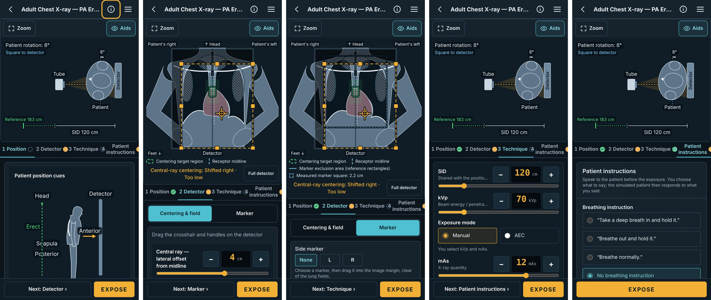
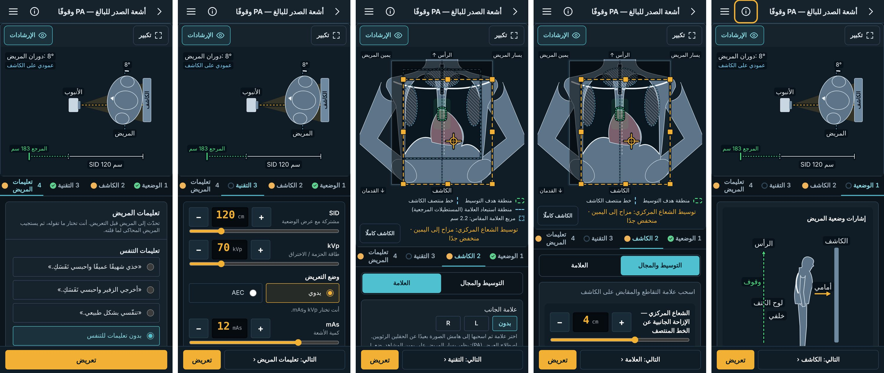

# RAD-103 المرحلة B — تبسيط محاكي الهاتف (D1–D7)، 2026-11-04

المرجع: [D1–D7](../../../DECISIONS.md#rad101-phone-ui-owner-2026-11-04) و[تقرير التدقيق](RAD-101_PHONE_UI_AUDIT_2026-11-04.md) (خُطِّطت باسم RAD-101). Draft واحد (#237)؛ الترتيب S-STD-1. **يُدمج بعد إطلاق الخميس بأمر المالك فقط.**

## 1. الانحرافات والميزانية

- **الترتيب:** commit 1 (الرقائق، D2) ← دمج main ‏(#234) مع تحديث RAD-103 ← commit تدقيق QA (قرار المالك) ← commits 2–5 كما في D7 ← commit الوثائق هذا. كل commit يُبنى وتمر اختباراته.
- **commit التدقيق اتسع بقرار المالك:** استثناء الأشرطة وحده لم يكفِ (الأعداد تساوت 2 مقابل 2 والرسم ظل مختلفًا لأن تسميات الحاسوب داخل الرسم)؛ اختار المالك الخيار 1 (§6).
- **مكان قائمة الجاهزية:** الشريط صار «التالي» + «تعريض» فقط (D1)، فانتقلت قائمة المطلوب (تلميح Practice) من الورقة السفلية إلى آخر الخطوة 4 وما زالت تصف زر التعريض. ليست «مراجعة»؛ لا جدول ولا ورقة. **يحتاج تأكيدك.**
- **«التالي» في الخطوة 2** يفتح قسم «العلامة» أولًا ثم الخطوة 3 (كما في النموذج)؛ الدخول بـ«التالي» يبدأ بـ«التوسيط والمجال».
- **نقطة العلامة الناقصة** تظهر على الخطوة 2 لا 1 (العلامة انتقلت إليها)؛ تغيير خريطة التبويب فقط، قاعدة الجاهزية كما هي.
- **أدوات QA عُدّلت مع السلوك:** `simulator-layout-audit` و`workspace.mjs` و`result-marker-audit` تتبع الخطوات والشريط والأقسام (القوائم في §6). لا عتبة خُففت.
- **البصمات (commit 5):** حارس الصدر بلا كاتب `UPDATE_*`؛ اتُّبعت سابقة #235: `UPDATE_CHEST_HASHES=1` عبر نسخة اختبار مؤقتة للكتابة فقط حُذفت. تغيّر 40 مفتاحًا بالضبط، كلها `scene|chest-pa-erect|…|ar|…`.

## 2. المنجز والمستبعد

| Commit | المنجز (هاتف فقط) |
|---|---|
| 1 D2 | رقائق ≥12px في صف ملاصق فوق الرسم وصف تحته (كما أقررت)، الجهات لا تنعكس؛ الهدف والمنتصف في سطر الإيضاح. [قبل/بعد](../../../review/rad-101/rad101-phase1-before-after.jpg) |
| 2 D1/D3/D4 | 4 خطوات مرقمة: الوضعية ← الكاشف ← التقنية ← تعليمات المريض، لكل خطوة تم/ملاحظة/لم تبدأ؛ «التالي» + «تعريض» في كل خطوة (لا «التالي» في الأخيرة)؛ المنظر يتبع الخطوة دون مبدّل؛ الإسقاط في الخطوة 1؛ «الإرشادات/تكبير/الكاشف كاملًا» بنص ظاهر |
| 3 D3/D4 | قسما «التوسيط والمجال» و«العلامة»؛ مناطق استبعاد العلامة ومربعها وسطراها في الإيضاح في «العلامة» فقط |
| 4 D6 | إزاحتا التوسيط وحجم المجال والدوران صفوف ± ظاهرة دائمًا (نفس المنزلقات بأسمائها + −/+)، مثل SID وkVp وmAs؛ السحب باقٍ |
| 5 D5 | «اللوح» ← «لوح الكتف» (مفتاح `positioning.scapula` وحده) |

المنظر لكل خطوة: الكاشف ← الكاشف؛ التقنية ← المنظر الثاني؛ الوضعية وتعليمات المريض ← المنظر الثاني للصدر الثلاثة (`positionView`) والكاشف لبقية الـ14 (الدوران مرسوم على الشكل في الأطراف والحوض والكتف).

**مستبعد:** تعطيل المقابض في قسم العلامة (لم يُقرر)؛ «اللوحان» بصيغة المثنى في نصوص التغذية الراجعة (خط توقف).

## 3. لكل مهمة

- **RAD-103:** نُفذت المرحلة B في Draft ‏#237؛ `review` بانتظار المالك (الدمج بعد الإطلاق + فحص الهاتف + موافقة النصوص). #237 هو الـPR الوحيد للتنفيذ.

## 4. التغييرات المشتركة وScale

- خصائص اختيارية فقط، غيابها = مخرج الحاسوب: `SceneLayout.positionView`، `SceneProps.step/section`، `SceneSlots.marker`، `DetectorWorkspace.markerGuides`، `MarkerGuideLegend.marker/centring`، `PhoneFrameLabels.minPx`. `ProjectionControl` مستخرج من `ConsolePanel` بنفس المخرج.
- `workspace-tabs.ts` نقي: ترتيب D3، `stepState`، `followingTab`، `DETECTOR_SECTIONS`.
- **Scale:** كل الفحوص الـ17 من المكونات المشتركة؛ ثلاثة تعريفات بيانات فقط. **السقف:** 4 خطوات ثابتة وقسمان؛ محفّز: فحص يحتاج خطوة خامسة أو تنقلًا إجباريًا في Assess. **سقف المساحة:** لوحة الخطوة 2 للصدر 219px ظاهرة من محتوى 488px فتتمرر داخليًا (المستند لا يتمرر)؛ محفّز التصغير: بلاغ من فحص الهاتف.

**نصوص واجهة جديدة/معدلة (تحتاج موافقتك قبل الدمج):**

| المفتاح `workspace.*` | EN | AR |
|---|---|---|
| tabs.positioning / centring / technique / patient | Position / Detector / Technique / Patient instructions | الوضعية / الكاشف / التقنية / تعليمات المريض |
| aids / zoom / wholeDetector | Aids / Zoom / Full detector | الإرشادات / تكبير / الكاشف كاملًا |
| nextStep | Next: {step} | التالي: {step} |
| stepDone / stepNotStarted (قارئ الشاشة) | done / not started | تم / لم تبدأ |
| sectionCentring / sectionMarker | Centering & field / Marker | التوسيط والمجال / العلامة |
| `positioning.scapula` | — | لوح الكتف |

حُذفت مفاتيح لم تعد مستخدمة: `sceneViews` و`viewDetector/Top/Side` و`readinessDetails` و`positioning.fineAdjustPhone`.

## 5. الطبي والتقييم

لا تغيير في التقييم أو `PRACTICE_EVALUATION_VERSION` أو الأوزان أو قواعد الجاهزية أو نصوص التغذية الراجعة أو تلميحات Practice (كلها ظاهرة: قائمة المطلوب، سطر التوسيط، الهدف، اصطلاح العلامة، مرجع SID) أو الصور أو الإحداثيات المحفوظة. لا ملف تحت evaluation/technique/data/domain ولا اختبارات QA. «لوح الكتف» نص اعتمده المالك.

## 6. QA (مرة في النهاية، بناء محلي، حالة اصطناعية بلا حسابات)

- **Verified:** typecheck؛ lint ‏(0 أخطاء، تحذيران قديمان)؛ اختبارات الوحدة 156 ملفًا / 2594 اختبارًا في كل commit؛ حراس scene-dom وcharacterisation وgoldens دون تغيير خارج مفاتيح commit 5.
- **Not run محليًا:** مسار DB (يحتاج PostgreSQL؛ يعمل في CI).
- **Verified، الحجم لكل commit** (`build:pages` ثم `health:sizes`، صفحات practice الـ34، سقف التوقف 495): 1: 482.8 · 2: 482.9 · 3: 483.2 · 4: 483.4 · 5: 483.4 KiB؛ 0 أخطاء.
- **Verified، commit التدقيق:** السكربت القديم يفشل في 12/1520 على main وعلى الفرع؛ الجديد يفشل على main ‏(2/1532: الرسغ 3 مقابل 2 من شريط main القديم) وينجح على الفرع. المحذوف من المقارنة على الجهتين: `g` تضم `text` ومستطيل `rect[rx="5"][opacity="0.82"]` فقط، و`g` من `line,polygon,line,polygon` داخل `svg[role=group]`، و`g` فارغة بعدهما؛ وتُستثنى SVG فيها `text[data-phone-frame-label]`. فحص النصوص يقارن تسميات الرسم + الأشرطة (دون ↑/↓) + `ul>li>span:has(>span[aria-hidden].border-dashed)` مع الحاسوب: لا ناقص ولا زائد.
- **Verified:** `simulator-layout-audit` (6 فحوص، EN/AR، 390/1440): 1688 فحصًا، 84 axe، 0 فشل. فحوص الهاتف المعدلة: الخطوات بترتيبها وحالاتها، المنظر يتبع الخطوة، رأس المشهد «تكبير/الإرشادات» بنص ولا مبدّل، الشريط «التالي» + «تعريض» فقط، «التالي» عبر القسمين، قائمة الجاهزية في الخطوة 4، لا ورقة جاهزية، الرسم يُقارن في قسم «العلامة»، صفوف ± ظاهرة (≤84px)، الدوران صف ±؛ «Aids» يقابل مربع «الإرشادات» نفسه في الحاسوب.
- **Verified:** `exam-audit --all`: 1122 فحصًا (17 × EN/AR × 390/1440)، 0 فشل، axe 0. `result-marker-audit` للصدر والرسغ: 60/60 موضعًا مطابقًا.
- **Verified:** `label-collisions --obstacles` للـ17: على 390 ‏0 في 3384 حالة؛ على 1440 (كود الحاسوب دون تغيير) 360 ملاحظة في الصدر الثلاثة فقط، مطابقة لما قبل.
- **Verified:** لقطات 390×844 ‏(DSF 2، مصغرة 75%) لخطوات الصدر PA: 1، 2 التوسيط، 2 العلامة، 3، 4.
- **Not run:** الهاتف الحقيقي (للمالك)؛ اختبار مع طلاب.

## 7. بنود مفتوحة

1. «لوح الكتف» أطول من «اللوح» فتعبر تسميتها ذراع الشكل في رسم إشارات الوضعية بالعربية (اللقطة AR، الخطوة 1). تحريكها يغيّر بصمات الصدر مرة أخرى؛ ينتظر قرارك.
2. قائمة الجاهزية في الخطوة 4 (§1) و«التالي» عبر قسم العلامة.
3. تمرير داخلي في لوحة الخطوة 2 (§4).

## 8. قائمة المالك وموجّه الجلسة التالية

- [ ] وافق على النصوص في §4 (EN/AR) أو عدّلها.
- [ ] بعد الإطلاق: افتح #237 على الهاتف (EN وAR): الخطوات الأربع، «التالي»، قسما الكاشف، صفوف ±، «لوح الكتف».
- [ ] قرر البنود 1–3 في §7.
- [ ] بعدها: «حوّل #237 إلى جاهز وادمجه» بأمر صريح.

**موجّه:** «طبّق قراراتي على §7 في #237 (RAD-103)، أعد QA المتأثر فقط، وأبقِ Draft.»
